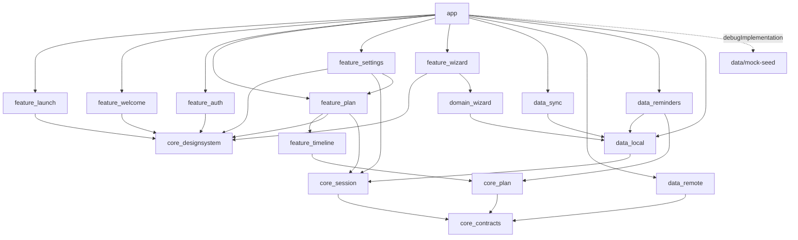

# 02 — iOS architecture as a blueprint for the Android app

Research date: 2026-11-15. Topic: how the native iOS app (`/Users/rickgout/Sites/chronoflow-ios`) is built, module by module, and what the Android (Kotlin + Jetpack Compose) equivalent should be.

## How to read this

- **[F]** marks a fact read in source, with a path (and line where it helps). Path shorthands:
  - `IOS` = `/Users/rickgout/Sites/chronoflow-ios`
  - `KIT` = `IOS/Packages/ChronoFlowKit/Sources`
  - `W` = `/Users/rickgout/Sites/chronoflow-new` (Laravel web/API)
  - `M` = `/Users/rickgout/Sites/chronoflow-mobile` (React Native)
- **[R]** marks my recommendation for Android.
- **[OQ-n]** marks an open question. Each has a recommended default so the plan can go ahead while the user is away. All of them are collected in §15.
- Exact library versions are left to the toolchain research. Every version must be pinned and at least two weeks old.

Correction to the task brief: ChronoFlowKit holds **about 328 Swift source files** (≈36.8k lines), not 1.9k. The `App/` target adds 40 files (≈4.2k lines). Generated contracts make up 3,808 of those lines (`KIT/AppCore/Contracts/Generated/TripPlan.swift`). Counted with `find … -name '*.swift'` per target; see §1.

---

## 0. Summary: what can be reused right away

The user asked: *"Does the iOS research/plan contain things you can already re-use?"* Yes, a lot. Sorted by how directly it carries over:

### 0.1 Files that can be reused as they are

These are platform-neutral data. Copy them into the Android repo and record where each came from.

| Asset | iOS path | Android use |
|---|---|---|
| Sanitized API response fixtures (auth, account, trips, errors, plans S1–S6, wizard) and their provenance READMEs | `IOS/Packages/ChronoFlowKit/Tests/DataAccessTests/Fixtures/{auth,account,trips,errors,plans,wizard}/*.json`, `Fixtures/README.md`, `*/SOURCE.md` | Test resources for API-client, mock-parity and sync tests. Each is pinned to a web or RN commit (`trips/SOURCE.md`: RN `e24872af…`, contracts pin web `afd80dc0…`) |
| Planner fixtures S1–S6 + `intl-cases.json` | `IOS/Packages/ChronoFlowKit/Tests/PlanCoreTests/Fixtures/` | Plan-logic and copy-formatter golden tests |
| Plan/review copy catalogue (289 keys, en+nl, plural "coded" cases) | `KIT/PlanCore/Resources/PlanCopy.json` (+ `SOURCE.md`) | Load it as a raw asset at runtime, the same way iOS does (`CopyCatalog.load()` runs on a worker, `KIT/PlanCore/CopyCatalog.swift:34`). Formats use Apple positional `%1$@`, so turn `@` into `s` when loading or when copying the file |
| Debug mock seed: account settings and 7 trips | Inline JSON in `KIT/DataAccess/Mock/MockAppSeed+Fixtures.swift` (≈680 KB) | Extract it to `mock-seed/src/main/resources/mock-seed.json`. Ship it only in debug builds (§5.6) |
| Mock scenario credentials | `KIT/DataAccess/Mock/MockScenarioValues.swift` | `demo@example.com` / `twofactor@example.com`, password `password`, 2FA `123456`, recovery `AbCdEf1234-GhIjKl5678`, IDs `0199a3c0-0000-7000-8000-000000000000` / `…0001` |
| Generators | `IOS/Tools/contracts-gen/generate.py`, `IOS/Tools/PlanCopyGen/*`, `IOS/Tools/TokenGen/{Plan,PlanUI,Settings}.source.json`, `plan-tokens.json`, `IOS/Tools/ReminderParity/export-selection.cjs` | Keep the inputs and pins. Write a Kotlin emitter for contracts and tokens (§13) |
| String catalogues (en+nl) | `IOS/App/Localizable.xcstrings`, `KIT/*/Resources/*.xcstrings` | Convert them to `values/strings.xml` + `values-nl/strings.xml` with a script. The keys are English sentences, so the converter has to make up resource names. The copy research covers the details |

### 0.2 Specs and decisions that carry over unchanged

These are platform-neutral sections of `IOS/plan.md`:

- **Readiness rules** (`plan.md:267–275`) and the pure reducer (`KIT/AppCore/LaunchReadiness.swift:108`). It ports line for line (§4.5).
- **Account schema v1** (`plan.md:382–433`, `KIT/LocalStore/SchemaV1.swift`) plus the `v2-no-health-data` migration (`KIT/LocalStore/NoHealthDataMigration.swift`) (§7).
- **API contract table, error envelope mapping and timeouts** (`plan.md:435–452`, `KIT/DataAccess/API/APIClient.swift`) (§5).
- **Sync sequence for one epoch** (`plan.md:459–465`), the outbox rules and the backoff numbers (§6).
- Decisions **D18–D27** (storage, data-source factory, session storage, device identity, SyncEngine, outbox, sign-out wipe, I/O ordering), with the platform API names swapped.
- Settled user answers in the Open-questions table (`plan.md:2376–2425`). Examples: OQ 21/22/27 (password policy and reset copy), OQ 25 (links open the app), OQ 29 (pending sign-out confirmation), OQ 31 (no producers for missing endpoints), OQ 34 (plan copy source), OQ 40 (wizard recovery row), OQ 41 (no credits, no hand-off), OQ 42 (no Add to calendar), OQ 43/44, OQ 46 (one date-time pill).
- The **test-tier philosophy** (`IOS/AGENTS.md` "Tests"): use the cheapest layer that can fail, run at most one UI journey per feature, launch seeded, and keep budgets (§11.4).

### 0.3 Things Android has to decide for itself

The splash (Core Animation layer tree → Android SplashScreen API + an overlay), Keychain → Android Keystore, GRDB → Room, URLSession → OkHttp, Observation → StateFlow/Compose, universal links → App Links (they need `assetlinks.json`, which the web does not serve yet), passkeys → Credential Manager (needs server work), local notifications → AlarmManager + NotificationManager, the Dynamic Type cap → a font-scale cap, and the scene life cycle → a single Activity + `ProcessLifecycleOwner`.

---

## 1. Targets and dependency graph (iOS)

### 1.1 SwiftPM targets
[F] `IOS/Packages/ChronoFlowKit/Package.swift`: Swift tools 6.4, `.iOS(.v17), .macOS(.v14)`, Swift 6 language mode. External dependencies: `GRDB.swift` **exact 7.8.0** and `swift-snapshot-testing` `upToNextMinor 1.19.0`.

| Target | Depends on | Default isolation | Files / lines | Role |
|---|---|---|---|---|
| `AppCore` | — | `nil` (nonisolated) | 42 / 6,792 (3,808 generated) | Contracts (DTOs), `DataSource` protocol, `DataFailure`, `SessionController`, readiness protocol + reducer, `LaunchCoordinator`, `Route`/`Navigator`, outbox change types, device identity, guest claim types, auth links |
| `DataAccess` | AppCore | nil | 25 / 3,388 | `APIClient`, `APIDataSource`, `MockDataSource` + mock server state, `DataSourceFactory`, Debug UI-test seed command |
| `LocalStore` | AppCore, GRDB | nil | 26 / 1,607 | `AccountDatabase` (GRDB pool), schema, records, repositories, `SyncEpoch`, `AccountWiper`, `AccountModel`, local mutations/enqueue |
| `Sync` | AppCore, LocalStore, TripWizard | nil | 12 / 1,380 | `SyncEngine`, `SyncLifecycle`, `SessionSync`, `FullPull`, `OutboxFlusher`, `PlanRetention`, `CheckOffReconciler` |
| `Reminders` | AppCore, LocalStore, PlanCore, GRDB | nil | 7 / 638 | Selection, schedule, ledger, `ReminderService`, `ReminderTapRouter` |
| `PlanCore` | AppCore | nil | 12 / 934 (+ `PlanCopy.json`) | Pure timeline/plan logic, copy catalogue and formatter, `PlanClock` |
| `TripWizard` | AppCore, DataAccess, LocalStore, Reminders | nil | 27 / 3,580 | Wizard models (member + guest), generation service, draft stores, guest session acceptance |
| `DesignSystem` | — | `MainActor` | 27 / 2,012 | Generated tokens, fonts, type metrics, shared controls |
| `Launch` | DesignSystem, AppCore | MainActor | 17 / 893 | Splash `LaunchTimeline`, CA layer scene, overlay controller |
| `Welcome` | DesignSystem, AppCore | MainActor | 8 / 308 | Welcome screen |
| `Auth` | DesignSystem, AppCore, DataAccess | MainActor | 30 / 2,753 | Sign-in/2FA/forgot/reset/sign-up/verify models + views, passkey providers |
| `PlanUI` | PlanCore, LocalStore, Sync, DesignSystem | MainActor | 51 / 5,653 | Today, My trips, trip page, **timeline renderer**, step sheets, walkthrough |
| `Settings` | AppCore, LocalStore, Sync, PlanCore, PlanUI, DesignSystem, Reminders, Auth | nil | 33 / 4,254 | Settings home + pages, terms update, sign-out pending sheet |
| `TripWizardUI` | TripWizard, DesignSystem, PlanCore | MainActor | 11 / 2,537 | Wizard screens |
| `SnapshotSupport` (test helper target) | AppCore | — | 8 | Snapshot profiles (`profiles.json`) |

Test targets: one per library (`AppCoreTests` … `WelcomeTests`, plus `ToolingTests`), 213 Swift test files in total. App-level suites: `IOS/AppTests` (hosted), `AppUITests` (XCUITest), `PerfUITests` (`LaunchPerfTests`, `TimelinePerfTests`), `ReleaseReadinessTests`, `RenderTests`.

### 1.2 Dependency graph (iOS, compile time)

```
                      ┌──────────── App (composition root, UIKit scene + SwiftUI) ────────────┐
                      │ imports every library below                                            │
                      └────────────────────────────────────────────────────────────────────────┘
 UI layer (MainActor): Launch  Welcome  Auth  PlanUI  TripWizardUI  Settings(nil-isolated, UI)
                          │       │      │      │          │            │
 Design:              DesignSystem ◄─────┴──────┴──────────┴────────────┘
 Domain/logic:         PlanCore   TripWizard ──► Reminders ──► PlanCore
                          │          │  │            │
 Data:                    │     DataAccess   Sync ──►│ LocalStore ──► GRDB 7.8.0
                          │          │        │  └──► TripWizard
 Core:                    └────► AppCore ◄────┴──────────────
```

Notable edges:
- `Sync → TripWizard`: the sync module stores trip-generation side effects (`KIT/Sync/TripGenerationEffects+Store.swift`).
- `Settings → PlanUI, Auth`: Settings reuses plan components and the passkey registration provider.
- UI modules never import `DataAccess`, except `Auth`. Screens see `DataSource` only through closures or `AppCore` protocols.

### 1.3 Isolation rule
[F] D1 (`plan.md:29`): "App/UI modules default `MainActor` isolation; core modules `nonisolated` + `Sendable`." This is enforced per target with `swiftSettings: [.defaultIsolation(...)]` (Package.swift).

[R] Android equivalent: pure Kotlin/JVM modules hold logic and have no Android dependency. Android library modules hold Room, Compose and platform services. UI state is only touched on `Dispatchers.Main.immediate`. Core code must never block the main thread (§8).

---

## 2. Composition root: the `App/` target

| File | Role [F] |
|---|---|
| `App/AppDelegate.swift` | `@main`. Owns the process-level `LaunchProcessState` (overlay only on the first scene connection, D14), the long-lived `NativeSessionController`, `AuthSessionServices`, the `RootNavigator`, and `UNUserNotificationCenterDelegate` (forwards taps as `PendingLaunchIntent`, shows banners in the foreground). `verificationRequired(epoch:)` routes to `.verify` after epoch checks (lines 44–56). |
| `App/SceneDelegate.swift` (732 lines) | Launch ordering (D3/D26). It (1) captures URLs, user activities and the notification response into `PendingLaunchIntent`, (2) creates the overlay window, plays the timeline and runs `CATransaction.flush()`, (3) registers fonts off the main thread, (4) builds services in `Task.detached` (`AppServices.launchConfiguration()`), (5) builds `NativeSessionController`, (6) runs `LaunchCoordinator` with `StoredDataReadiness`, (7) mounts the SwiftUI root in the next run-loop turn, and (8) tears down the overlay and starts `observeGates`. It forwards `sceneDidBecomeActive`/`sceneDidEnterBackground` to `setActive` and `protectedDataDidBecomeAvailable` to `readiness.retry()`. Debug only: the UI-test reseed over `chronoflow-uitest://reseed`. |
| `App/Session/AppServices.swift` | `nonisolated struct AppServices: Sendable`. Reads Info.plist `CHRONOFLOW_READINESS` (`native`/`signed-out`), `CHRONOFLOW_DATA_SOURCE` (`mock`/`api`) and `CHRONOFLOW_API_BASE_URL`, then builds the `DataSourceFactory`. Picks Keychain credentials per namespace or test, the reminder centre (mock when a UI test is running) and the mock store (file or memory). Debug only: the signed-in seed (`seedSignedIn`). |
| `App/Session/NativeSessionController.swift` | `@MainActor` wiring object. Builds `ReminderService`, `AccountModel`, `SessionAccountDatabase`, Keychain stores, `GuestWizardStore`, `SessionSync`, `AccountWiper`, the `SessionTeardown` closures and the `SessionController`. Exposes `readiness` (lazy `StoredDataReadiness`), `setActive`, `refreshNow`, `wizardGenerationService`, `observe()` (attaches reminders and `AccountModel` per epoch) and `observeGates`. |
| `App/Session/AuthSessionServices.swift` | `@MainActor @Observable`. Builds `SignInModel` (with closures for device identity, guest claim and acceptance routing), `GuestResetLinkRouter`, `VerifyEmailModel` (made fresh per verification context and epoch), passkey providers (system on API, deterministic on mock) and the guest wizard factory. Debug only: mock `failNext` hooks driven by environment variables. |
| `App/RootView.swift` | `RootNavigator` (`@Observable`, `revision` + `route`). The root `switch` over `Route` mounts Welcome / AuthRootView / GuestWizardDestination / AppTabs / Terms / Walkthrough / Verify. Applies device preferences (language, theme) and the Dynamic Type cap. |
| `App/AppTabs.swift` (549 lines) | The signed-in shell: `TabView` with 3 `NavigationStack`s. Builds every signed-in screen model in a `.task` (§10), handles wizard recovery, guest continuation and reminder-tap routing, and tears everything down when the session epoch changes. |
| `App/TripPageDestination.swift` | Builds `TripPageModel` **in `init`** so the page exists on the push's first frame (lines 63–65), then wires sync events, the first-trip reminders offer, trip actions and wizard hand-off. |
| `App/{Terms,Walkthrough,Reminders,GuestWizard}Destination.swift`, `AuthRootView.swift` | Thin destinations that build their models from `NativeSessionController`. |
| `App/Readiness/*` | `KeychainSessionStore`, `KeychainGuestSecretStore`, `StubReadiness` (Debug launch-argument readiness). |
| `App/Debug/*` | Debug seeds: `TripPageDiagnosticRoot` (`-cf.trip-page`), `UITestSessionFixture`, `WizardBoardCaptureSeed`, `SettingsBoardCaptureFixture`, `UITestRuntime`, `RoutePlaceholder` (the D17 seam). |

[R] Android composition root (`:app`):
- `ChronoFlowApplication : Application`. Does no I/O in `onCreate`. It holds the process-level `LaunchProcessState` and an `AppGraph` that is created lazily.
- `MainActivity : ComponentActivity`, the only Activity. It calls `installSplashScreen()`, then `setContent { Root() }`, and draws the launch overlay first. It starts service construction on `Dispatchers.IO` only after the first frame has been committed (D26 equivalent, §4.5).
- `AppServices` (data class) builds `DataSourceFactory` from `BuildConfig` fields (§12).
- `NativeSession` holds the same responsibilities as `NativeSessionController`. `AuthSession` matches `AuthSessionServices`.
- `RootNavigator` exposes a `StateFlow<RootState(route, revision)>`. `Root()` is a `when (route)` switch.
- Debug seeds live in `app/src/debug/kotlin/…` behind a `DebugHooks` interface, and the release source set has a no-op implementation. iOS sprinkles `#if DEBUG` and `UIApplication.shared.delegate as? AppDelegate` lookups through view code (for example `AppTabs.swift:200–330`). Avoid that on Android.

---

## 3. Module mapping at a glance

| iOS target | Android Gradle module | Type | Main libraries |
|---|---|---|---|
| AppCore (contracts) | `:core:contracts` | Kotlin/JVM | kotlinx.serialization (generated DTOs) |
| AppCore (logic) | `:core:session` | Kotlin/JVM | kotlinx.coroutines |
| DataAccess | `:data:remote` (API + mock source) | Kotlin/JVM | OkHttp, kotlinx.serialization |
| DataAccess (Debug seed) | `:data:mock-seed` | Kotlin/JVM, `debugImplementation` only | — |
| LocalStore | `:data:local` | Android library | Room (+ `androidx.sqlite` bundled driver) |
| Sync | `:data:sync` | Android library (depends on `:data:local`) | coroutines |
| Reminders | `:data:reminders` | Android library | AlarmManager, NotificationManagerCompat |
| PlanCore | `:core:plan` | Kotlin/JVM | — (`PlanCopy.json` resource) |
| TripWizard | `:domain:wizard` | Kotlin/JVM (or Android library if it must touch Room types) | — |
| DesignSystem | `:core:designsystem` | Android library + Compose | Compose, generated tokens, fonts |
| Launch | `:feature:launch` | Android library + Compose | core-splashscreen |
| Welcome | `:feature:welcome` | Android library + Compose | — |
| Auth | `:feature:auth` | Android library + Compose | androidx.credentials (passkeys) |
| PlanUI | `:feature:plan` + **`:feature:timeline`** | Android library + Compose | — |
| Settings | `:feature:settings` | Android library + Compose | — |
| TripWizardUI | `:feature:wizard` | Android library + Compose | — |
| SnapshotSupport + fakes | `:core:testing` | Kotlin/JVM (test fixtures) | Turbine, coroutines-test |
| App | `:app` | Android application | Navigation 3, Lifecycle |
| PerfUITests | `:benchmark` | `com.android.test` | Macrobenchmark, Baseline Profile |

Full proposal, dependency rules and reasons are in §13.

---

## 4. AppCore, part by part

### 4.1 Storage namespaces
[F] `KIT/AppCore/StorageNamespace.swift:1–8`:
- `api` → directory `ChronoFlow`, Keychain service `net.chronoflow.app.native`
- `mock` → directory `ChronoFlowMock`, Keychain service `net.chronoflow.app.native.mock`

The namespace follows from the data-source factory (`DataSourceFactory.namespace`, `KIT/DataAccess/DataSourceFactory.swift:24`). Mock and API accounts, sessions and secrets never mix.

On-disk layout [F], all relative to `Library/Application Support/`:

| Item | Path |
|---|---|
| Account DB | `<ns>/Accounts/<accountUUID>/account-<accountUUID>.db` (+WAL/SHM) (`AccountDatabase.swift:76–80`, `:52`) |
| Wipe marker | `<ns>/pending-wipe.json` (`AccountWiper.swift:26`) |
| Guest wizard recovery | `<ns>/guest-wizard.json` (`GuestSecretStore.swift:28–33`) |
| Mock server state | `ChronoFlowMock/Server/state.json` (`MockServerState.swift:156`) |
| UI-test roots (Debug) | `AuthUITests/<testId>/…`, `TimelineFixtures/…` (`AppServices.swift:165–169`) |

[R] Android: `enum class StorageNamespace(val dir: String, val keyAlias: String) { Api("ChronoFlow", "net.chronoflow.app.native"), Mock("ChronoFlowMock", "net.chronoflow.app.native.mock") }`. The root is **`context.noBackupFilesDir`**. That keeps account data out of Auto Backup and device-to-device transfer, which matches D19's `isExcludedFromBackup` (§7.4). Keep the same relative layout under it.

### 4.2 Session credentials (`SessionStore`)
[F]
- `StoredSession {token, accountId}` is JSON. `parse` rejects blank fields (`KIT/AppCore/SessionStore.swift:3–19`).
- `SessionStore` protocol: `read/write/delete` of `Data` (`:21–25`). `readStoredSession()` **deletes** malformed data and returns nil (`:28–35`).
- Keychain implementation `App/Readiness/KeychainSessionStore.swift`: generic password, service per namespace, account `"session"`, `kSecAttrAccessibleWhenUnlockedThisDeviceOnly`. It asserts it is not on the main thread. No refresh token: the server owns the 90-day sliding expiry (D21; `W/app/Actions/Api/IssueMobileToken.php`, `W/app/Listeners/RefreshMobileTokenExpiry.php`).
- Temporary Keychain failures surface as `SessionFailure.credentialsUnavailable` and are retried (`StoredDataReadiness.restore()`, `KIT/AppCore/StoredDataReadiness.swift:44–58`). They **never delete data**.

[R] Android: `KeystoreSessionStore : SessionStore`.
- An AES-256-GCM key lives in `AndroidKeyStore`: alias `"<ns.keyAlias>.session"`, `PURPOSE_ENCRYPT|DECRYPT`, no user authentication.
- The ciphertext and IV go in a small file `noBackupFilesDir/<ns>/session.bin`, written atomically (`AtomicFile`).
- Every call runs on `Dispatchers.IO`. Keep the same JSON shape `{"token","accountId"}`.
- Do **not** use `EncryptedSharedPreferences`. `androidx.security:security-crypto` is deprecated.
- A `KeyPermanentlyInvalidatedException` or a decrypt failure counts as "malformed", so delete and sign out. This matches `parse`. An `IOException` while reading counts as "temporarily unavailable" and is retried.
- [OQ-1] Should the key use `setUnlockedDeviceRequired(true)` (API 28+) to mirror `WhenUnlocked`? Default **no**: the app only reads the token in the foreground, and the flag causes OEM-specific failures. `ThisDeviceOnly` is already covered by a non-exportable Keystore key plus no backup.

### 4.3 `SessionController` (the heart of the app)
[F] `KIT/AppCore/SessionController.swift` (437 lines), an `actor` that implements `SessionControlling {restore(), accept(_:), signOut(discardPending:unauthorized:)}`.

State: `presence: SessionPresence?` (`.signedIn(accountID)` / `.signedOut`), `epoch: UInt64`, `storedSession`, `mutationPermit`, `generation`, `transitioning`.

1. **Serialisation.** Every operation chains onto `tail` (a `Task` that awaits the previous one), so restore, accept, sign-out and verification run strictly in order (`:160–208`). `generation` increments on each new restore or accept. Later steps check `check(generation)` and throw `SessionFailure.superseded` (`:337–340`).
2. **Publication.** `publish(_:)` invalidates the old `SessionMutationPermit`, creates a new one if signed in, **increments `epoch`** and yields `SessionUpdate{presence, epoch}` to every observer (`:425–431`). Observers get an `AsyncStream` with `bufferingNewest(1)` and the current value replayed (`:149–156`).
3. **`activeSession()`** returns `SessionSnapshot{session, epoch}` only when the controller is not transitioning and presence matches the stored session (`:138–143`). Every consumer checks `activeSession() == snapshot` before and after each await. This is the main guard against cross-account leaks.
4. **restore()** (`:342–388`): `stopSync()` → `teardown.prepare()` (close DB + recover any pending wipe) → read credentials. No credentials: close the DB and publish signed-out. Invalid account ID: delete credentials, close, signed-out. Otherwise `accounts.open(id)` → publish signed-in → `requestSync(epoch)`.
5. **accept(result)** (`:390–423`): validate the token and UUID → `stopSync` → `prepare`. If a *different* account is signed in, publish signed-out first. Then open the DB → `upsert(account)` → **write credentials (the commit point)** → publish signed-in → `requestSync`. A DB failure never publishes an unusable session (D21).
6. **Sign-out** (`:222–335`):
   - `signOut(discardPending:unauthorized:)` and `signOut(expected:discardPending:)` are scoped to an epoch. `unauthorized(epoch:)` is the forced 401 path.
   - Concurrent requests merge into one `signOutFlight`.
   - "Once requested, cleanup must complete even if its UI caller disappears" (`:271`).
   - Order: if not forced and not discarding, read `pendingCount` → try `flush` → if rows are still pending, return **`.needsConfirmation(pendingCount:)`**. Otherwise `beginWipe(id)` (writes the marker) → clear `storedSession` and **publish signed-out first** → `stopSync` → best-effort `logout` raced against a **3 s** timer (skipped when forced) → `detach` → close the DB → `erase(id)` → delete credentials → `finishWipe`.
   - `pendingUnauthorizedEpoch` plus `retryUnauthorized()` retry a failed forced wipe when the app becomes active again (`:232–247`).
7. `confirmEmailVerification(expected:email:)` marks the account verified in the DB and requests sync (`:194–220`).

[F] `SessionMutationPermit` (`KIT/AppCore/SessionMutationPermit.swift`): an `NSLock` and a `valid` flag. `whileValid { }` holds the lock **through the SQLite transaction**, so publication cannot revoke a session while one of its writes is half-committed.

[F] `SessionTeardown` (`KIT/AppCore/SignOutResult.swift:8–19`) is a struct of closures: `prepare, pendingCount, flush, beginWipe, erase, finishWipe, logout, detach, sleep`. `NativeSessionController` fills them in (`App/Session/NativeSessionController.swift:78–97`). This is the main test seam for sign-out.

[R] Android: `class SessionController(…)` in `:core:session` (pure Kotlin).
- Serialisation: one `Mutex` plus a `CoroutineScope(SupervisorJob() + dispatcher)` owned by the app graph, **or** an actor-style `Channel<Command>` read by one coroutine. I recommend the Mutex: `suspend fun restore() = mutex.withLock { … }` plus an `AtomicLong generation`.
- `epoch` and `presence` live in a `MutableStateFlow<SessionUpdate?>`, published only while holding the mutex.
- Wrap the sign-out body in `withContext(NonCancellable)` once it has been requested. That mirrors "cleanup must complete".
- The 3 s logout race is `withTimeoutOrNull(3.seconds) { source.signOut() }`. Inject the dispatcher so tests can use virtual time.
- `SessionMutationPermit` is a `ReentrantLock` + `@Volatile valid`. `whileValid {}` runs **blocking** code only (the Room transaction body, §7.5). Never suspend while holding it.
- Keep `SessionTeardown` as a data class of `suspend` lambdas with the same nine members.

### 4.4 Sign-out wipe (`AccountWiper`)
[F] `KIT/LocalStore/AccountWiper.swift`:
- `begin(id)` writes the marker `pending-wipe.json` containing the account UUID (backup-excluded, file protection).
- `recover()` (called from `teardown.prepare` on every restore or accept) finishes an interrupted wipe: `erase` + delete credentials + `finish`.
- `erase(id)` removes `<ns>/Accounts/<id>/`, **all** guest secrets and `guest-wizard.json`.
- Device identity and device preferences survive (D22/D25).

[R] Android: the same actor-like class in `:data:local`. The marker is written atomically. Removal is `File.deleteRecursively()` on the account directory, after `RoomDatabase.close()`. A test must check that `-wal`/`-shm` are gone.

### 4.5 Launch coordinator and readiness
[F] Protocol `LaunchReadiness` (`KIT/AppCore/LaunchReadiness.swift:22–29`): `session()`, `gate()`, `gateUpdates()`, `hasStoredData()`, `storedDataUpdates()`, `allowFirstLoad()`.

[F] Pure reducer `reduce(_ state: inout LaunchState, _ event: LaunchEvent, reduceMotion:) -> [LaunchEffect]` (`:108–186`):
- Events: `session`, `gate`, `storedData`, `moonAnchor`, `reached(Duration)`, `exitCompleted`.
- Effects: `commitStatus(at:)`, `cancelStatus`, `commitExit(ending, at:, moonTarget:)`, `forceReady`.
- Numbers:
  - Signed out → ending `welcome`, exit at `max(1600 ms, now)` (`:118`).
  - Ready + app → exit at `max(1500 ms, now)` (`:169`).
  - Status at `max(2 s, now)` when `hasStoredData == false` and not ready (`:159`).
  - At **8 s** readiness is forced. If the session is still unknown, it counts as signed out (`:140–151`).
  - With Reduce Motion, the exit happens immediately.
- Ready = signed out, or (session && gate && (gate ≠ app || hasStoredData == true)) (`:152–154`).
- The welcome flight waits for the measured moon anchor until `exitStart − 50 ms`, then uses `fallbackTarget` (`:174–183`).

[F] `LaunchCoordinator` (`KIT/AppCore/LaunchCoordinator.swift`, `@MainActor`):
- Subscribes to `readiness.session()`. When signed in, it also subscribes to `gateUpdates()` and `storedDataUpdates()`.
- Schedules ticks at 2 s and 8 s on the injected `LaunchClock`, plus the welcome deadline.
- Calls `onChange(state, effects)`. On `.forceReady` it calls `readiness.allowFirstLoad()`.

[F] `StoredDataReadiness` (`KIT/AppCore/StoredDataReadiness.swift`, actor):
- `session()` runs `controller.restore()` with retry-on-signal. `retry()` is called on activation and protected-data unlock.
- Values come from `AccountReadinessRepository.values(accountID:)` (`KIT/LocalStore/AccountReadinessRepository.swift`), a GRDB observation that derives the gate.
- **Gate precedence:** `!hasVerifiedEmail → verify`; `policies == nil → nil` (unresolved); `acceptedTermsVersion != termsVersion → terms`; `!walkthroughSeen (or a pending walkthrough outbox row) → walkthrough`; else `app`.
- `hasStoredData = account.synced_at != nil`. `firstLoadGate = walkthroughSeen ? .app : .walkthrough` is used only after `allowFirstLoad()` for the current epoch.

[F] Other readiness implementations:
- `SignedOutReadiness`: used by the Perf build (`CHRONOFLOW_READINESS=signed-out`).
- `UnavailableReadiness`: used when service construction fails.
- `StubReadiness`: Debug, driven by `-cf.session/-cf.gate/-cf.stored/-cf.readyDelay`.

[R] Android:
- Port `LaunchState`, `LaunchEvent`, `LaunchEffect` and `reduce` **line for line** into `:core:session` (package `launch`) as pure Kotlin with `kotlin.time.Duration`. Port its iOS tests (`LaunchReadinessTests`) as JVM tests. Map `CGRect` to a small `RectF`-like data class so the module stays JVM-only.
- `LaunchCoordinator` becomes a class on `Dispatchers.Main.immediate` with an injected `LaunchClock` interface (`now(): Duration`, `suspend fun sleepUntil(d: Duration)`). Under test, back it with `TestCoroutineScheduler`.
- `LaunchReadiness` becomes an interface with `suspend fun session()` and `fun gateUpdates(): Flow<Gate>`. Room `Flow` replaces GRDB observation (§7.6).
- **I/O ordering (D26):**
  - `Application.onCreate` does nothing heavy.
  - In `MainActivity.onCreate`, call `installSplashScreen()` and set content with the overlay.
  - Start `AppServices` construction after the first frame: `window.decorView.doOnPreDraw` → `lifecycleScope.launch(Dispatchers.IO)`, or `Choreographer.postFrameCallback`.
  - Register fonts lazily (Compose font loading is already asynchronous; preload on IO).
  - Add a debug `StrictMode` thread policy (`detectDiskReads/Writes`, `penaltyDeath` in debug) as the Android version of iOS `assert(!Thread.isMainThread)`.
- **Overlay only on the first Activity creation in the process (D14):** keep a process-level `LaunchProcessState.claimOverlay()` in the Application. Recreating the Activity (theme or locale change) must not replay the splash. The splash rendering itself belongs to the launch research. Its structure is: reducer + clock + effect handler that commits keyframe tracks.

### 4.6 Routes and gates
[F] `Route` (`KIT/AppCore/Route.swift:1–3`): `welcome, today, signIn, guestWizard, terms, verify, walkthrough, trips, settings`. `Navigator` is a `@MainActor` protocol with `navigate(to:)`. `Gate.route`: verify→`.verify`, terms→`.terms`, walkthrough→`.walkthrough`, app→`.today` (`LaunchReadiness.swift:9–19`).

[F] `SessionGateRouter` (`KIT/AppCore/SessionGateRouter.swift`, `@MainActor`):
- Observes `controller.updates()`.
- For each signed-in epoch, it observes `readiness.gateUpdates()` and navigates whenever the gate changes. Duplicates are dropped. `verify` calls the `verification` callback instead of navigating directly.
- On signed-out it navigates to `.signIn`, but **only after it has seen a signed-in state**, so the launch Welcome is left alone.
- It is started after the overlay is removed (`SceneDelegate.finishLaunch`, `observeGates`).

[R] Android: the same class with `Flow` (`controller.updates.collectLatest { … readiness.gateUpdates().distinctUntilChanged().collect { … } }`). `collectLatest` replaces the iOS `gateTask?.cancel()`. Keep the `sawSignedIn` latch.

### 4.7 Outbox contract types
[F] `KIT/AppCore/OutboxChange.swift`:
- `OutboxKind` raw values: `check-off, settings, complete-trip, profile, data-export, security, walkthrough`.
- `SettingsSection`: `bodyClock, preferences, reminders`.
- `OutboxChange`: `checkOff(CheckOffChange{tripID, plan_input_hash, type, local_date, ordinal, status?})`, `settings(section, patch: JSONObject)`, `policies(version)`, `profile({name,email})`, `walkthrough`, `unsupported(kind,payload)`.
- `MutationReceipt`: `acknowledged | account(AccountSnapshot) | identity(AccountIdentity) | checks(TripCheckResult)`.
- Note: the check-off JSON key is `tripID` (camelCase with a capital D), while the others are snake_case. Keep this exactly, because stored payloads and the dependency key parser read `tripID`/`tripId` (`KIT/LocalStore/LocalMutations.swift:38–50`).

[R] A Kotlin `sealed interface OutboxChange` with `@Serializable` payload classes and explicit `@SerialName`s. Keep unknown kinds decodable as `Unsupported` (OQ 31 rule: park, never drop).

### 4.8 Guest claim
[F] Pieces:
- `GuestClaim {draftToken, inputRevision, reviewRevision, guestSecret}` (`KIT/AppCore/GuestClaim.swift`).
- `GuestSecretStore` protocol: `set/get/delete/rotate/deleteAll`, keyed by draft token (`KIT/AppCore/GuestSecretStore.swift`). Keychain implementation: service `<ns.keychainService>.guest-secrets`, account = token, `kSecAttrAccessibleAfterFirstUnlockThisDeviceOnly` (`App/Readiness/KeychainGuestSecretStore.swift`).
- Guest draft file `guest-wizard.json` (`GuestWizardStore`, `KIT/TripWizard/Model/GuestWizardStore.swift`). Recovery expires after **30 min** (`GuestRecoveryGate.decision`, `KIT/TripWizard/Model/GuestRecoveryGate.swift:10`) and waits for the hand-off and intro to finish (`SceneDelegate.scheduleGuestRecovery`).

[F] Flow:
1. `SignInModel` asks `claim()`, which returns `guestWizardStore.claim(secrets:)`.
2. It sends `draft_token`/`guest_secret` with login, passkey login or register.
3. The server may return `tripId` (`SessionResult.tripId`).
4. `GuestSessionAcceptance.accept` (`KIT/TripWizard/Model/GuestSessionAcceptance.swift:29–53`) chooses:
   - With a `tripId`: store continuation `.trip(id)` and delete the secret.
   - Without one but with a draft, by method: password/passkey → seed the member wizard and continue `.memberWizard`; two-factor → `.trips`; sign-up → none.
5. It discards the guest draft and secret.
6. The continuation is stored in the `settings` table under section `guestContinuation` (`KIT/LocalStore/GuestContinuationRepository.swift`). AppTabs consumes it once the gate is `app` (`App/AppTabs.swift:338–368`).

[R] Port as is. The guest-secret store uses the same Keystore wrapper as §4.2 with a second key alias `<ns>.guest-secrets`. Secrets are stored in a small encrypted map file.

### 4.9 Device identity
[F] `KIT/AppCore/DeviceIdentityStore.swift`:
- An actor that creates a **UUIDv7** once (`UUIDv7.generate`, `:12–26`, with a 48-bit ms timestamp and version/variant bits).
- It validates a persisted value as v7 and lowercases it. In-flight requests are de-duplicated.
- Persisted by `DevicePreferences` under `UserDefaults` key **`api.deviceId`** (`KIT/AppCore/DevicePreferences.swift`). It survives sign-out and wipe.
- `deviceName(name, model)` trims and falls back to the model, capped at **255 Unicode scalars** (`:86–95`).
- Clock and randomness are injectable.
- Sent as `device_id`/`device_name` on login, register and passkey login.

[R] Port `UUIDv7` and `DeviceIdentityStore` to `:core:session`. Persist in a Preferences **DataStore** file `device.preferences_pb` under `noBackupFilesDir`, or plain DataStore. Device name: `Settings.Global.DEVICE_NAME` (readable without a permission on API 25+), else `Build.MODEL`, trimmed to 255 code points. Never use `ANDROID_ID` or an advertising ID as the identity (mirrors "never IDFA/IDFV").

### 4.10 Preferences
[F] There are three kinds of settings:
1. **Device preferences** (survive wipe). `api.deviceId` in UserDefaults. Theme and language in `SettingsDevicePreferences` (`KIT/Settings/SettingsDevicePreferences.swift`): keys **`cf.settings.theme`** (`system|light|dark`) and **`cf.settings.language`** (`system|en|nl`). `resolvedLocale` maps phone `nl`→nl, anything else→en, and keeps the phone's hour cycle. UI tests use a separate suite `ChronoFlow.Settings.UITest.<uuid>` (`App/SettingsPreferenceStore.swift`). Launch arguments `-cf.settings.theme dark` work because iOS feeds `-key value` arguments into UserDefaults.
2. **Account settings** (synced). These are rows in the `settings` table: `bodyClock, preferences (timeFormat, hiddenCategories, showOptionalItems, language), reminders (light, avoid, caffeine, winddown, leadMin), planCredits, policies, sleepAnswered, …, syncFailure, guestContinuation`. They are edited through the outbox.
3. **Root presentation.** `RootView` applies `.environment(\.locale, …)`, `.preferredColorScheme`, and caps Dynamic Type at xxLarge (`App/RootView.swift:56–66`).

[R] Android:
- Device preferences: one Preferences DataStore (`device_prefs`) with the same key names, wrapped in `DevicePreferences`. Expose `StateFlow<Theme>` and `StateFlow<LanguageChoice>`.
- Language: use `AppCompatDelegate.setApplicationLocales(LocaleListCompat.forLanguageTags("nl"))`, the per-app language that uses `LocaleManager` on API 33+. Also declare `android:localeConfig` with `en, nl` so the system settings page lists the app. "System" maps to an empty locale list, with the rule `nl` else `en` applied in the resolver.
- Theme: `AppCompatDelegate.setDefaultNightMode`, or pass it down as `isSystemInDarkTheme()` overrides in `ChronoFlowTheme`.
- Font scale cap (xxLarge equivalent): wrap content in `CompositionLocalProvider(LocalDensity provides Density(density, fontScale.coerceAtMost(CAP)))`. **[OQ-2]** What is the cap? Default: **1.3** (iOS xxLarge is about 1.3× the default body size). The design research may refine this.

### 4.11 Failures, links and intents
[F] `DataFailure` (`KIT/AppCore/DataFailure.swift:33–56`): `reviewExpired, notEnoughCredits, saveCapacity, profileInvalid(fields), offline, unauthorized(status), emailUnverified(status), validation(fields,status), throttled(retryAfterSeconds,status), conflict(status), server(status?), unsupported(kind)`, plus `status`. `FieldMessage {key, arguments}` turns Laravel `:name` and RN `{{name}}` placeholders into catalogue placeholders (`interpolationKey`).

[F] `AuthLink(url:)` (`KIT/AppCore/AuthLink.swift`) accepts only `https://app.chronoflow.net` with no port, user, password or fragment:
- `/email/verify/{uuid}/{40-hex}?expires={digits}&signature={64-hex}` with exactly those two query items → `.verify(SignedVerificationInput)`. A malformed verify link gives `.verify(nil)`, which shows the "failed" state.
- `/reset-password/{token}?email=…` with exactly one query item → `.reset(ResetPasswordLink)`. An invalid one gives empty fields, which the UI shows as invalid.

[F] `PendingLaunchIntent {urls, notification}` holds cold-start URLs and notification responses. Rule 7: they never change the launch ending. They are used after the overlay is gone (`SceneDelegate.consumePendingReminderIntent`).

[R] Port `DataFailure` as a `sealed class` (it is an `Exception` so it can be thrown). Port `FieldMessage` and its interpolation (Android placeholders: `%1$s`/`%1$d`). Port `AuthLink` parsing on `android.net.Uri`, or better `java.net.URI`, to keep it JVM-testable. Keep the exact-shape checks and percent-decoding rules.

### 4.12 Contracts
[F]
- `KIT/AppCore/Contracts/Generated/TripPlan.swift` says "Generated by Tools/contracts-gen from web e36368ec…". It translates the TypeScript types at `W/resources/js/types/App/{Data/Api, Data/Trips, Data/Plan, Planner/Output, Planner/Input, Enums, Planning/Copy}/index.ts` at the pinned commit (`IOS/Tools/contracts-gen/generate.py:11–12`), with renames such as `ApiTripListItem→TripListItem` and `ApiTripDetail→TripDetail`. String enums decode unknown values to `.unknown(String)`.
- Hand-written DTOs live in `AuthContracts`, `AccountTripContracts`, `PasskeyContracts`, `PasskeyManagementContracts`, `ProfilePreferences`, `TripWizardContracts`, `GuestTripReviewInput`, `JSONValue`, `CopyLine`.
- `TripDetailResponse` keeps the raw bytes (`response.data`), so the DB stores the exact server JSON (`TripRepository.applyDetail`, `KIT/LocalStore/TripRepository.swift:105–123`).

[R] Port `generate.py` with a Kotlin emitter that reads the **same pin**. Output `@Serializable` data classes and value-class enums with an `Unknown(raw)` fallback (a custom `KSerializer`). Commit the output and add a freshness check task. Use `Json { ignoreUnknownKeys = true; explicitNulls = false }` for decoding responses, but keep the raw JSON when storing (as iOS does). Use `JsonObject` for the extensible account presentation objects.

---

## 5. DataAccess

### 5.1 `DataSource` interface
[F] `KIT/AppCore/DataSource.swift`, 25 async methods:

- **Auth:** `passkeyOptions, passkeyLogin, signIn → SignInResult(.session|.twoFactor(challengeId)), completeTwoFactor, signUp, requestPasswordReset, resetPassword, verificationStatus, resendVerificationEmail, verifyEmail, signOut`
- **Account:** `deleteAccount(password), accountSecurity(change)`. Both have default throwing implementations.
- **Reads:** `fetchIdentity, fetchAccount, fetchTrips, fetchTripDetail`
- **Wizard:** `searchAirports, reviewTrip, reviewGuestTrip, reviewTripEdit, saveTrip, updateTrip, tripInput`
- **Outbox:** `send(OutboxChange) → MutationReceipt`

[R] `interface DataSource` in `:core:contracts` (or `:core:session`) with `suspend` functions and the same names. Errors are thrown as `DataFailure`.

### 5.2 `DataSourceFactory` and configuration
[F] `KIT/DataAccess/DataSourceFactory.swift`:
- `setting ∈ {mock, api}`, otherwise it throws `invalidSource`.
- `APIBaseURL` validation: scheme http/https, and **https only in Release**; a host is required; valid port; no user, password, query or fragment; no `.`/`..` path segments.
- When `testing` is true, the source is forced to mock.
- No silent fallback from API to mock (D20).
- Configuration comes from `IOS/Config/Base.xcconfig`: `CHRONOFLOW_DATA_SOURCE = mock`, `CHRONOFLOW_API_BASE_URL = https://api.chronoflow.net/v1`, `CHRONOFLOW_READINESS = native`. The Perf configuration uses `CHRONOFLOW_READINESS: signed-out` and `CHRONOFLOW_TIMELINE_PERF` (`IOS/project.yml:63–68`). **Note: the default source is `mock` even in Release.** API is an explicit override.

[R] Android: put `BuildConfig.DATA_SOURCE` and `BuildConfig.API_BASE_URL` on a `dataSource` product flavor dimension: `mock` and `api`. Release builds for distribution use `apiRelease`. Port the factory and the base-URL validation exactly, with HTTPS required when `!BuildConfig.DEBUG`. A clear-text network security config is allowed only for debug and local Valet hosts. **[OQ-3]** Should `release` default to API? Default: **yes, use flavors.** `mockRelease` stays buildable for performance comparisons, the way iOS Release can run mock.

### 5.3 `APIClient` and endpoints
[F] `KIT/DataAccess/API/APIClient.swift` (actor):

- **Session:** ephemeral, cookie storage off, `httpShouldSetCookies=false`, no URL cache, `reloadIgnoringLocalCacheData`, no credential storage. A redirect delegate refuses **every** redirect (`APIRedirectDelegate.swift`).
- **Headers:** `Accept: application/json`; `Content-Type: application/json` when there is a body. `Authorization: Bearer` only for `.authenticated` endpoints. A missing token throws `.unauthorized(401)` **without sending** the request.
- **Timeouts:** each request races a `sleep(timeout)` task, and a timeout becomes **`.offline`**. Defaults: 15 s; 90 s for register, wizard review and save; 3 s for logout. Cancellation stays `CancellationError`. Any transport error becomes `.offline`.
- **Status check:** `request(expectedStatus:)` (default 200; trip save expects 201). `requestNoContent` requires 204 and an empty body.
- **Error mapping** (`:118–168`):
  - 429 → `throttled(retryAfterSeconds)`. The value comes from body `retryAfterSeconds`, else the `Retry-After` header as seconds or an HTTP date, else 60.
  - Without a decodable envelope `{code,message,errors?,args?,retryAfterSeconds?}` → `server(status)`.
  - `(401,"unauthenticated")` → unauthorized
  - `(403,"email_unverified")` → emailUnverified
  - `(422,"review_expired")` → reviewExpired
  - `(422,"validation_failed")` with valid `errors` → `validation(fields)`, with args that are strings or numbers only
  - `(409,"conflict")` → conflict. The three 2FA-state messages become a `form` validation instead.
  - Anything else → `server`.
- **URLs:** `APIEndpoint.url` percent-encodes each path segment with the allowed set `[A-Za-z0-9-_~]`, sorts the query, and encodes `+` as `%2B` (`KIT/DataAccess/API/APIEndpoint.swift`).

[F] Endpoints (`KIT/DataAccess/API/APIDataSource.swift`, `+TripWizard.swift`, `+AccountSecurity.swift`). These match `W/routes/api.php:46–131` under domain `domains.api`, prefix `v1`:

| Method | Path | Access | Timeout | Result |
|---|---|---|---|---|
| POST | `auth/passkey/options` | public | 15 | `ApiPasskeyChallenge`, validated: 64-char id, `rpId app.chronoflow.net`, `timeout 60000`, 43-char b64url challenge of 32 bytes |
| POST | `auth/passkey/login` | public | 15 | `SessionResult` |
| POST | `auth/login` | public | 15 | `SignInResult` |
| POST | `auth/two-factor` | public | 15 | `SessionResult` |
| POST | `auth/register` | public | **90** | `SessionResult` |
| POST | `auth/forgot-password` | public | 15 | 204 |
| POST | `auth/reset-password` | public | 15 | 204 |
| POST | `email/verification-notification` | auth | 15 | `EmailVerificationStatus` |
| POST | `email/verify` | auth | 15 | `EmailVerificationStatus` |
| POST | `auth/logout` | auth | **3** | 204 |
| GET | `users/me` | auth | 15 | `AccountIdentity` (`verificationStatus()` reuses this, with resend 0) |
| GET | `account` | auth | 15 | `AccountSnapshot` |
| GET | `trips` | auth | 15 | `{trips:[TripListItem]}`, validated non-empty `card.id`/`departureUtc` |
| GET | `trips/{id}` | auth | 15 | `TripDetailResponse` (raw bytes kept; `trip.id` must match) |
| PUT | `trips/{id}/checks` | auth | 15 | `TripCheckResult` |
| PATCH | `account/{body-clock|preferences|reminders}` | auth | 15 | `AccountSnapshot` (patch validated by `SettingsPatchValidation`) |
| PATCH | `users/me` | auth | 15 | `AccountIdentity` |
| POST | `terms/acceptance` `{accepted:true,version}` | auth | 15 | 204 |
| POST | `walkthrough` | auth | 15 | 204 |
| GET | `airports?query=&limit=` | public | 15 | `ApiAirportSearchResults` |
| POST | `trips/review`, `trips/{id}/review` (+`source_revision`) | auth | 90 | `ApiTripReview` |
| POST | `guest/trips/review` | public | 90 | `ApiTripReview` |
| POST/PUT | `trips` (201) / `trips/{id}` (200, +`source_revision`) | auth | 90 | `ApiTripSaveResult` |
| GET | `trips/{id}/input` | auth | 15 | `ApiTripInputSnapshot` |
| — | account security (password, 2FA, recovery codes, passkeys, delete) | auth | 15 | see `APIDataSource+AccountSecurity.swift` |

[R] Android `ApiClient` in `:data:remote`:
- OkHttp: `followRedirects(false)`, `followSslRedirects(false)`, `cookieJar(CookieJar.NO_COOKIES)`, no `Cache`, no interceptors that add headers globally.
- Each call: `suspendCancellableCoroutine` around `Call.enqueue`, cancelling the `Call` when the coroutine is cancelled. The timeout is `withTimeout(endpoint.timeout)` on an **injected** dispatcher, and a timeout becomes `DataFailure.Offline`. Also set `call.timeout()` as a backstop.
- Decode with kotlinx.serialization.
- Port `ApiEndpoint` (method, path segments, access, body bytes, query, timeout) and `mapError` exactly.
- Do not use Retrofit. A small hand-written client keeps per-call timeouts, error mapping and the raw bytes the detail store needs.
- [F] The server sends ETags on GETs (`cache.headers:private;no_cache;etag`, `W/routes/api.php:124`), but iOS does not use them. [R] For parity, keep no HTTP cache. Logged as **[OQ-4]**: optional ETag use later; default no.

### 5.4 Mock server (`MockDataSource`)
[F] `KIT/DataAccess/Mock/MockDataSource.swift` (1,106 lines, actor):

- **Options:** `store: MockStateStore` (`MemoryMockStateStore` or `FileMockStateStore` at `ChronoFlowMock/Server/state.json`), optional `seed`, `offline`, `mutationsOffline`, injected `now/delay/sleep/id/bearer/assertionProvider`.
- **Latency:** each call sleeps `min(0.8, max(0.3, delay()))` (300–800 ms). Debug UI tests bypass this with their own `sleep`.
- **Test controls:** `setOffline(_:)`, one-shot `failNext(method:error:)` keyed by `MockMethod` (26 cases), and `inbox()` (`MockMail`: password-reset and verification mails carrying the signed input).
- **Server rules modelled:** sessions are per device (a new login replaces the same account+device), 90-day expiry extended on each request, 5/min rate windows (`MockRateLimiter`), passkey failures limited to 20/hour, the password policy (12 chars, mixed case, a number, a symbol), validation keys identical to the backend, an HMAC-signed verification URL, reset revoking tokens, guest claims (`MockClaim`), wizard review/save receipts and paid directions, and the account-security flows.
- **State:** `MockServerState.schemaVersion = 2`. On Debug load it is refreshed with `MockAppSeed.refresh(now)`, which rebases the fixture dates to "now".
- **Seeds:** `MockAppSeed.make(now:unverified:walkthroughSeen:termsPending:includeTimelinePerformanceTrips:)` builds two accounts (demo, two-factor), seven trips rebased to now, plus `large30`/`large60` synthetic trips when asked (`MockTimelineFixtures`).

[R] `MockDataSource` in `:data:remote/mock`, a Kotlin class whose state is guarded by a `Mutex`, with the same behaviour and the same `failNext`/`setOffline`/`inbox` controls. Persisted mock state is a JSON file under `noBackupFilesDir/ChronoFlowMock/Server/state.json`. **Contract parity tests:** feed the same JSON fixtures through `ApiClient` + `MockWebServer` and through `MockDataSource`, and require equal results and `DataFailure`s. That is the iOS `DataSourceParityTests` pattern.

### 5.5 UI-test seeding, launch arguments and environment
[F] Launch arguments (Debug unless stated). Sources: `App/LaunchArguments.swift`, `AppServices.swift`, `UITestSeedCommand.swift:33–37`, `Docs/perf-timeline.md`.

| Argument | Effect |
|---|---|
| `-cf.mode ready|slow|welcome` | Fixed splash ending (Release keeps `ready` only) |
| `-cf.freezeAt <ms>` | Freeze the splash at time t |
| `-cf.readyAt <ms>` | Ready time for `slow` (default 4600) |
| `-cf.mainThreadStall <ms>` | Block the main thread at 300 ms (Release too, for the D3 proof) |
| `-cf.reduceMotion` | Force Reduce Motion |
| `-cf.session in|out|never`, `-cf.gate <gate>`, `-cf.stored yes|no|never`, `-cf.readyDelay <s>` | `StubReadiness` |
| **`-cf.trip-page S1…S6|large30|large60|<uuid>`** | Open an isolated mock-backed trip page without auth (`TripPageDiagnosticRoot`; also in the Perf build via `CHRONOFLOW_TIMELINE_PERF`) |
| `-cf.timeline-fixtures` | Add large30/large60 to an isolated in-memory mock server, DB and credentials |
| `-cf.isolatedMockServer` | In-memory mock state |
| `-cf.notificationAuthorization <perm>` | Mock reminder centre permission |
| `-cf.twoFactorServerFailure`, `-cf.forgotServerFailure`, `-cf.forgotThrottleFailure` | `failNext` hooks |
| `-cf.firstTripReminders` | Show the reminders sheet |
| `-cf.settings.language`, `-cf.settings.theme` | Device preferences (UserDefaults argument domain) |

[F] Environment (Debug, honoured only with a valid `CF_AUTH_TEST_ID` UUID; `KIT/DataAccess/AuthUITestConfiguration.swift`, `App/AppTabs.swift`, `App/Session/AuthSessionServices.swift`):
- **Base:** `CF_AUTH_TEST_ID`, `CF_UI_TEST_PROFILE=screen` (fast launch + reseed), `CF_MOCK_DELAY`.
- **Account state:** `CF_AUTH_TEST_SIGNED_IN=demo|twofactor`, `CF_AUTH_TEST_OFFLINE`, `CF_AUTH_TEST_UNVERIFIED`, `CF_AUTH_TEST_WALKTHROUGH_SEEN`, `CF_AUTH_TEST_TERMS_PENDING`, `CF_SETTINGS_TEST_PENDING`, `CF_WALKTHROUGH_TEST_PENDING`.
- **Auth screens and failures:** `CF_AUTH_TEST_AUDIT_SCREEN`, `CF_AUTH_TEST_AUDIT_STATE`, `CF_AUTH_TEST_VERIFY_STATE`, `CF_AUTH_TEST_RESET_FAILURE`, `CF_AUTH_TEST_SIGNUP_FAILURE`, `CF_AUTH_TEST_LINK`.
- **Wizard:** `CF_GUEST_RECOVERY_BOARD`, `CF_GUEST_WIZARD`, `CF_GUEST_WIZARD_JOURNEY`, `CF_WIZARD_BOARD_CAPTURE`, `CF_WIZARD_AUTO_OPEN`.
- **Screens:** `CF_SETTINGS_ROUTE`, `CF_PLAN_TEST_SHEET`, `CF_PLAN_TEST_ROUTE`, `CF_PLAN_TEST_BLOCK`, `CF_PLAN_TEST_POSITION`, `CF_PLAN_TEST_FREEZE_CLOCK`, `CF_REFRESH_TEST_COUNTER`, `CF_REFRESH_TEST_EMPTY_TRIPS`.
- **Reseed:** `CF_UI_TEST_LAUNCH_ARGUMENTS`.

[F] Seeded sign-in:
1. `AppServices.seedSignedIn` runs `MockSessionSeed.run` after the overlay commit: mock sign-in → optional 2FA → `SessionController.accept` → `FullPull`.
2. It writes a `signed-in-seed.done` marker so a relaunch never brings back a session after sign-out (`KIT/Sync/MockSessionSeed.swift`).
3. Credentials use a separate Keychain service `…mock.uitest.<id>`.

[F] **In-app reseed (Debug):**
- The test calls `XCUIDevice.shared.system.open("chronoflow-uitest://reseed?payload=<base64 JSON UITestSeedCommand{authorization,nonce,environment,arguments}>")` (`AppUITests/UIReseed.swift`).
- The app checks: scheme and host, payload < 32 KB, the authorisation UUID matches the launch, a UUID nonce, `CF_UI_TEST_PROFILE == screen`, environment keys only `CF_*`, and no change to launch-level settings (`changedLaunchSettings`).
- It then tears down the session and window, resets the mock root, rebuilds services and remounts.
- It acknowledges with a window identifier `uitest.ready.<nonce>` (or `uitest.failed.<nonce>`).
- Result: one cold launch per test class, and a reseed between tests.

[R] Android:
- Launch configuration comes from **Intent extras** on `MainActivity` (debug only): `cf.mode`, `cf.trip-page`, … plus a `Bundle` of `CF_*` strings. Instrumentation tests use `ActivityScenario.launch(intent)`. Macrobenchmark uses `startActivityAndWait { it.putExtra("cf.trip-page","large60") }`.
- `-cf.settings.*` maps to extras that the debug `DevicePreferences` reads at startup.
- Reseed: a debug-only exported `Activity` or `BroadcastReceiver` takes `chronoflow-uitest://reseed?payload=…` with the same JSON and the same validation, so the iOS `UITestSeedCommand` contract is reused. Acknowledge through a `testTag`/semantics node `uitest.ready.<nonce>` in the Compose tree.
- Keep the "launch once per class, reseed between tests" rule. It was the iOS fix for slow UI suites (`AGENTS.md` Tests).
- Fast-launch tests disable animations: `UIView.setAnimationsEnabled(false)` and `window.layer.speed = 20` on iOS. On Android use the instrumentation `animationsDisabled` option and `adb shell settings put global animator_duration_scale 0`.

### 5.6 Fixtures
[F]
- Mock trips: one inline JSON with settings + 7 trip templates (`MockAppSeed+Fixtures.swift`). They are rebased to now by `MockTripFixtures.rebase`, which rewrites UTC instants and local dates per zone and recomputes tick offsets.
- `MockTimelineFixtures.fixture(named:)` serves `S1…S6`, `large30`, `large60` (repeated S3 days plus S1 caffeine blocks) or a trip id.
- Test fixtures are listed in §0.1.

[R] Put fixtures in `:data:mock-seed/src/main/resources/` and depend on that module only from `debugImplementation` and `benchmarkImplementation`. Release builds then contain no seed, matching "Release excludes the demo seed". Port `rebase` with `java.time` (`ZoneId`, `Instant`, `LocalDate`) and test it against the iOS-rebased output for a fixed `now`.

---

## 6. Sync engine

### 6.1 Layers
[F] There are three layers, each one an actor:

1. **`SessionSync`** (`KIT/Sync/SessionSync.swift`): one per app. It owns a `SyncLifecycle` for the attached epoch.
   - `requestStart(controller, epoch)` is called from the `SessionController.requestSync` hook.
   - `start(session, epoch)` builds `SyncEpoch(accountID, generation: epoch)`.
   - `resume` runs on activation. `setEnabled(false)` runs on background and **detaches**, keeping the retry state for that epoch.
   - It also offers `stop`, `refreshNow`, `requestSync`, and the epoch-checked one-off operations `fetchDetail(tripID)`, `deleteAccount` and `accountSecurity`. These forward a 401 to `unauthorized(epoch)` and a 403 to `verification(epoch)`.
   - `events()` replays the latest `SyncEvent`.
2. **`SyncLifecycle`** (`KIT/Sync/SyncLifecycle.swift`): triggers and backoff.
   - **Triggers:** `start` (DB open or sign-in); new outbox row IDs (it observes the outbox table, `:74–85`); a reconnect after being offline (from `SyncPathMonitoring`, `:86–101`); activation (`resume`); `refreshNow` (pull-to-refresh).
   - **Backoff** (`:144–156`): `exponential = min(2^min(failures, 9), 300)` s, `failures += 1`, `delay = max(exponential, retryAfter)`. A server `retryAfter` sets a **server deadline**, and new requests before it reschedule rather than run (`:105–114`). `refreshNow` returns the last result while that deadline holds (`:120–126`).
   - **Results:** offline cancels retry and waits for a trigger. `unauthorized` calls `unauthorized(epoch)` once, outside the listener. `verificationRequired` calls `verification(epoch)` and resets failures.
   - Startup seeds `failures` from the largest `attempts` among pending outbox rows (`:63–64`).
3. **`SyncEngine`** (`KIT/Sync/SyncEngine.swift`): one flight and one rerun.
   - `requestSync()` debounces **1 s**. If a flight is running, it sets `rerun`.
   - `refreshNow()` joins the current flight or starts one under a **child epoch**. `RefreshWaiters` cancels the flight only when the *last* waiter cancels.
   - `runFlights` loops while `rerun`, merging retry-after values (max) and refusals, and stops early on unauthorized or verificationRequired. It emits `started`/`finished(result)` with `SyncChanges` (trip counts added/updated/removed and plan versions changed), computed by diffing a snapshot before and after.
   - `cancelAndWait()` invalidates epochs, cancels and **awaits** the flight, timers and detail tasks.

### 6.2 One run (`runOnce`, `SyncEngine.swift:200–272`)
[F]
1. `isOnline()`. The default always returns true: connectivity is only a trigger hint, and real failures are typed `.offline`.
2. If the local account is unverified: `fetchIdentity` → write it. If still unverified → `verificationRequired` (protected pulls are skipped, to avoid a 403 loop).
3. `OutboxFlusher.run` (§6.3). If offline → state offline. If the walkthrough POST got a 401 → state failed (no sign-out; this is the 17f exception).
4. `FullPull.run` (`KIT/Sync/FullPull.swift`):
   - `users/me` → write the identity, keeping pending profile and walkthrough values. Unverified → stop, and **do not set `synced_at`**.
   - `GET account` (the id must match, and it must be verified) → `GET trips`.
   - **One transaction:** write the snapshot (keeping pending settings sections), `applyCards` (tombstone missing cards with `deleted_at`, an empty list included; never bring back `deleted_locally`; a pending `complete-trip` forces status completed), `UPDATE account SET synced_at`, `evictPlans(held:)`.
   - Then, for each card that is kept offline or held by a lease, where the stored `(trip, planInputHash)` version is missing or `detailVersion` differs: `GET trips/{id}` → `applyDetail` (store raw JSON + checks in one transaction). A 404 is skipped (no tombstone). Other errors set `retryAfter = 1`. unauthorized, emailUnverified, offline and throttled are rethrown.
5. Error mapping: offline → offline. unauthorized → unauthorized. emailUnverified → verificationRequired and `has_verified_email=0`. throttled → failed with retryAfter. Anything else → failed with `retryAfter=1`.

### 6.3 Outbox replay
[F] `KIT/Sync/OutboxFlusher.swift`, `OutboxFailurePolicy.swift`, `KIT/LocalStore/LocalMutations.swift`:
- **Enqueue** (`OutboxRepository.enqueue`, `LocalMutations.swift:55–131`): the ID is a UUIDv7 and `created_at` is ISO-8601 UTC with fractional seconds. The **local mutation and the outbox insert commit in one transaction**, under the session mutation permit:
  - Check-off: set the mark.
  - Settings: merge the snake_case patch into camelCase local keys. Body clock also sets `sleepAnswered` and deletes `readiness`.
  - Policies: set accepted version and time, de-duplicated against a pending row.
  - Profile: name only, and the email must be unchanged (otherwise `onlineOnly`). Stores `previousName`.
  - Walkthrough: set seen, de-duplicated.
  - Allowed settings keys are validated (`safeSettings`).
- **Order:** `pending()` ordered by `(created_at, id)`, FIFO.
- **Dependency key** (`LocalMutations.swift:38–45`): `settings:<section>`, `trip:<tripID>` (check-off, complete-trip), otherwise the kind. A failed or parked row **blocks later rows with the same key only**.
- **Check-off preparation** (`CheckOffReconciler`):
  - If the trip was deleted, drop the row.
  - If the input hash is stale: fetch the detail, re-key by stable `(type, local_date, ordinal)` if that step still exists, else drop the row and its old mark. Never overwrite a newer mark.
  - A stale response (`409`, or 422 with `plan_input_hash`, or the form key "This plan has changed. Refresh it before marking this step.") is refreshed **once** and retried.
- **Receipt** is applied in the same transaction that deletes the row (`StoreApplication.receipt`).
- **Final refusal:** `OutboxFailurePolicy.isFinal` = status in 4xx and not in {401, 408, 425, 429}, and not emailUnverified. It does not apply to walkthrough rows or stale check-offs. The engine writes `settings.syncFailure = SyncRefusal{id, kind, status, failedAt, lastError(sanitized), notice}` and removes the row atomically. For a check-off it also nulls `detail_version` to force a refetch. `SyncRefusalNotice`: `sleepTimes` (body-clock patch with only sleep fields) or `stepDone(type)`. It is surfaced through `RefusedChangeModel`/`RefusedChangeFeedback` in PlanUI.
- **Transient failure:** `attempts += 1`, `last_error` = a sanitized code (`offline`, `server`, …). `retryAfter = max(min(2^min(attempts−1, 9), 300), serverRetryAfter)`. The dependency is blocked. Offline ends the flush.
- **Unsupported kinds** (`complete-trip`, `data-export`, `security`): parked, never sent, never dropped (OQ 31).
- Secrets (passwords, tokens, 2FA codes, link secrets) are never written to the outbox, DB or logs (D24).

### 6.4 Epochs
[F] `SyncEpoch` (`KIT/LocalStore/SyncEpoch.swift`) is a final class with `accountID`, `generation`, an `NSLock`-guarded `valid` flag and an optional `parent`.
- `child()` builds a sub-epoch (per flight or per detail fetch).
- `check()` = task not cancelled **and** valid, all the way up the parent chain.
- `whileValid {}` holds the lock(s) through an SQLite commit (`AccountDatabase.write(epoch:permit:)`, `KIT/LocalStore/AccountDatabase.swift:116–141`). So once `invalidate()` returns, **no write for that epoch can land**. Cancelling a task invalidates its epoch (`onCancel`).

Every awaited response checks the epoch before it is applied (D23). As a result, "an old 401 must never wipe a newly signed-in session".

### 6.5 Retention (plan leases)
[F] `PlanRetention` (`KIT/Sync/PlanRetention.swift`):
- `hold(tripID) → PlanLease`, released on `release()` or deinit. `withHeldPlans {}` reads the held set under the lock.
- `TripPageModel` holds a lease while a trip page is open (`KIT/PlanUI/TripPage/TripPageModel.swift:79`).
- Eviction (`TripRepository.evictPlans`, `TripRepository.swift:125–139`) deletes `plan_versions` + `check_marks` for trips that are not pending-referenced, not held, and either deleted or not `keepOffline`.

### 6.6 Offline behaviour
[F] Cached account and trip data stays readable and editable offline (check-offs, settings, walkthrough, terms acceptance, name). Auth, wizard and trip deletion are online-only (D24). There is no background task scheduler: sync runs only while the scene is active.

[R] Android:
- `SessionSync`, `SyncLifecycle` and `SyncEngine` become classes in `:data:sync`, each with its own `Mutex` or confined dispatcher (`Dispatchers.Default.limitedParallelism(1)`). Use one app-scoped `CoroutineScope` with injected `CoroutineDispatcher`s and a `SyncScheduler { now(): Instant; suspend sleep(d) }` (iOS `SyncScheduler`, `KIT/Sync/SyncStatus.swift:33–43`).
- Events: `MutableSharedFlow<SyncEvent>(replay = 1, onBufferOverflow = DROP_OLDEST)`.
- Debounce: a `Job` that is cancelled and restarted. Do not use `Flow.debounce`, so the rerun and timer-drain semantics can be ported exactly.
- `SyncEpoch`: `ReentrantLock` + `@Volatile valid` + parent. `check()` = `currentCoroutineContext().ensureActive()` + valid.
- Path monitor: `ConnectivityManager.registerDefaultNetworkCallback` behind `interface SyncPathMonitoring { fun updates(): Flow<Boolean>; suspend fun stop() }`, emitting `NET_CAPABILITY_VALIDATED`-aware online flags. Only trigger on offline→online, as iOS does.
- Activation: `ProcessLifecycleOwner.get().lifecycle` ON_START → `setActive(true)` (resume sync, reschedule reminders, `retryUnauthorized`, `readiness.retry()`); ON_STOP → `setActive(false)`. Serialise them the way `SceneDelegate.setActive` chains `activityTask`.
- **No WorkManager periodic sync**, to keep parity. **[OQ-5]** Should Android add background sync? Default **no**.
- **Port the iOS host tests** (35+ sync tests: flight/rerun, cancellation at every await, wrong epoch, backoff sequences) as JVM tests with `runTest` virtual time. They are the behavioural spec.

---

## 7. Local persistence

### 7.1 Store
[F] GRDB **7.8.0**, one `DatabasePool` per *active* account (`KIT/LocalStore/AccountDatabase.swift`).
- `open(accountID:)` asserts it is not on the main thread, validates the UUID path component, and creates the directory with file protection `completeUntilFirstUserAuthentication` and `isExcludedFromBackup` (re-applied after open to cover the `-wal`/`-shm` sidecars, `:174–186`).
- Every connection runs `PRAGMA foreign_keys = ON` and asserts it. `journal_mode` must be `wal`.
- Migrator: `v1` (`SchemaV1.migrate`) and `v2-no-health-data` (`NoHealthDataMigration`: rewrites body-clock values, deletes `readiness`, cleans outbox body-clock patches, legacy plan JSON and drafts containing retired medical answers).
- A failed migration closes and throws `StoreFailure.migration`. There is no destructive fallback.
- `SessionAccountDatabase` (`KIT/LocalStore/SessionAccountDatabase.swift`) switches the active DB. It closes the old one first and hides a closing DB (`activeDatabase()` returns nil while closing).

### 7.2 Schema v1 (exact, `KIT/LocalStore/SchemaV1.swift`)
```sql
account(id TEXT PK, name TEXT NN, email TEXT NN, has_verified_email INTEGER NN DEFAULT true,
        synced_at TEXT, walkthrough_seen INTEGER NN DEFAULT false)
trips(id TEXT PK, card TEXT NN, adaptation TEXT, form TEXT, revision TEXT, current_input_hash TEXT,
      keep_offline INTEGER NN DEFAULT false, departure_utc TEXT NN, plan_start_utc TEXT, plan_start_zone TEXT,
      preparation_days INTEGER, plan_end_utc TEXT, plan_end_date TEXT, deleted_at TEXT,
      deleted_locally INTEGER NN DEFAULT false)
plan_versions(trip_id TEXT NN REFERENCES trips(id) ON DELETE CASCADE, input_hash TEXT NN, detail TEXT NN,
              received_at TEXT NN, detail_version TEXT, PRIMARY KEY(trip_id, input_hash))
check_marks(trip_id, input_hash, type, local_date TEXT NN, ordinal INTEGER NN, status TEXT NN, marked_at TEXT NN,
            PRIMARY KEY(trip_id, input_hash, type, local_date, ordinal))
settings(section TEXT PK, value TEXT NN)
drafts(id TEXT PK, trip_id TEXT, form TEXT NN, base_form TEXT, dirty INTEGER NN DEFAULT true, review TEXT,
       token TEXT, input_revision INTEGER NN DEFAULT 0, review_revision INTEGER, wizard_source_revision TEXT,
       wizard_review TEXT, furthest_step TEXT, wizard_state TEXT, source_revision TEXT, save_failure TEXT,
       field_errors TEXT, updated_at TEXT NN)
outbox(id TEXT PK, kind TEXT NN, payload TEXT NN, created_at TEXT NN, attempts INTEGER NN DEFAULT 0, last_error TEXT)
```
JSON columns hold raw JSON text (`JSONDocument`, encoded with sorted keys). Settings sections: see §4.10. The wizard recovery row is one fixed-id `drafts` row with a 30-min expiry (OQ 40).

### 7.3 Repositories (all value types holding `AccountDatabase`)
[F]
- `AccountRepository`: `account()`, `values()`
- `TripRepository`: `trips/values/plan/checks/planValues/checkValues/store`, statics `applyCards/applyDetail/evictPlans`
- `SettingsRepository`
- `DraftRepository`
- `OutboxRepository`: `pending`, `values`, `enqueue`
- `AccountReadinessRepository`
- `GuestContinuationRepository`
- `StoreApplication`: shared write helpers `identity/snapshot/receipt/refuse/setting/checks/setMark/pending`
- `LocalMutations`

### 7.4 Encryption and keychain usage
[F] There is **no custom DB encryption** (D19: "No custom encryption/key beside the existing session Keychain"). Protection is iOS file protection plus backup exclusion. The Keychain holds only the session token (`WhenUnlockedThisDeviceOnly`) and guest secrets (`AfterFirstUnlockThisDeviceOnly`). Backup exclusion covers the whole account directory, including unsent outbox rows (OQ 26: development default; unsent changes are lost on device restore).

[R] Android:
- DB under `noBackupFilesDir/<ns>/Accounts/<uuid>/account-<uuid>.db`. The app is not Direct-Boot aware, so files sit in credential-encrypted storage. That matches "after first unlock".
- **No SQLCipher.**
- Also set `android:allowBackup="false"` **or** `dataExtractionRules` that exclude everything except device preferences. **[OQ-6]** Default: `allowBackup=false` + `fullBackupContent=false`, the simplest and closest to the iOS backup exclusion. Device theme and language are then not restored either. Accept that.

### 7.5 Android store choice
[R] **Room** (the AndroidX standard, KSP, Flow observation, migrations, KMP-ready), with:
- `@Entity` classes that mirror §7.2 **column for column**, with exact names and `@ColumnInfo(defaultValue = "true"/"false"/"0")`. The `plan_versions` FK uses `onDelete = CASCADE`.
- `RoomDatabase.Builder(context, AccountDb::class.java, path)` with `setJournalMode(WRITE_AHEAD_LOGGING)`, a `RoomDatabase.Callback.onOpen` that runs `PRAGMA foreign_keys=ON` and **asserts** it, a `setQueryCoroutineContext`/executor on IO, and **no** `fallbackToDestructiveMigration`.
- Version 1 = schema v1. Version 2 = the no-health-data data migration (port `NoHealthDataMigration` as a `Migration(1, 2)` that only touches data). There are no legacy users, so a fresh Android install creates version 2 directly, but keep both steps for parity and testability.
- `@RawQuery`/`SupportSQLiteDatabase` helpers for the handful of hand-written SQL statements (`UPDATE outbox SET attempts=attempts+1 …`, `DELETE FROM check_marks …`). Port the SQL text verbatim.
- **Transactions under epoch and permit:** Room's suspend `withTransaction` may suspend, so do not hold a JVM lock around it. Instead run `db.runInTransaction { epoch.whileValid { permit?.whileValid { body() } } }` as **blocking** code on a dedicated single-thread writer dispatcher (`Dispatchers.IO.limitedParallelism(1)`). This reproduces GRDB's `writeWithoutTransaction { whileValid { inTransaction {…} } }` exactly. Hold the lock only for that short blocking section.
- One `AccountDatabase` wrapper class (open/close/read/write/observe) exposes the same API as iOS, so repositories port line for line.
- Alternative considered: **SQLDelight**. It has first-class raw SQL that would match GRDB's style even better. Rejected for now because Room's invalidation-tracker Flows and Android tooling (Database Inspector, KSP schema export) are the platform default. **[OQ-7]** Default: Room.

### 7.6 Observation
[F] `AccountDatabase.observe` runs `ValueObservation.tracking(fetch)` on a dedicated serial queue `net.chronoflow.store.observation`. It returns an `AsyncThrowingStream` with `bufferingNewest(1)`, cancelled on termination and on `close()` (`:143–161`). There is no synchronous initial fetch on MainActor. `AccountModel` (`KIT/LocalStore/AccountModel.swift`) is a `@MainActor @Observable` adapter with `attach(repository, epoch, ifCurrent: token)` and `detach()`. A generation counter blocks stale deliveries.

[R] Room DAO `Flow<T>` (re-queries when a table is invalidated) + `.conflate()` + `.flowOn(Dispatchers.IO)`. `distinctUntilChanged()` only where the iOS consumer de-duplicates. On close, cancel collectors by cancelling a per-account `CoroutineScope` before `RoomDatabase.close()`. `AccountModel` becomes a class with `StateFlow<LoadState>` and the same attachment-token guard.

---

## 8. Concurrency model

[F] iOS:
- Swift 6 strict concurrency. UI modules are `MainActor` by default, and core modules are `nonisolated`. Every stateful service is an **actor**: `SessionController`, `StoredDataReadiness`, `AccountDatabase`, `SessionAccountDatabase`, `AccountWiper`, `SyncEngine`, `SyncLifecycle`, `SessionSync`, `MockDataSource`, `APIClient`, `DeviceIdentityStore`, `DevicePreferences`, `KeychainSessionStore`, `GuestWizardStore`, `MemberWizardStore`, `PlanDecoder`, `ReminderService`.
- State streams are `AsyncStream`/`AsyncThrowingStream` with `bufferingNewest(1)` (latest value wins). The sync event stream buffers 32 and the `SessionSync` relay buffers 1.
- Guards: **epoch** (session publication counter) + **generation** (supersession) + `Task.isCancelled` checks after every `await`, and **locks held through SQLite commit** (`SessionMutationPermit`, `SyncEpoch`).
- Serial queues are built from `tail` task chains (`SessionController`) and from `activityTask` chains (`SceneDelegate.setActive`).
- Cancellation is cooperative. `withTaskCancellationHandler` propagates to child tasks and invalidates epochs.
- Heavy work stays off the main thread: `PlanDecoder` (an actor) decodes and lays out the timeline. `CopyCatalog.load` runs detached. Records are decoded inside DB read closures.
- `assert(!Thread.isMainThread)` appears in every I/O entry point.

[R] Kotlin mapping:

| iOS | Kotlin/Android |
|---|---|
| `actor X` | class with a private `Mutex` (`mutex.withLock`) **or** confined to `limitedParallelism(1)`. Prefer the Mutex for request/response APIs |
| `@MainActor` model | ViewModel or state holder that updates `MutableStateFlow` on `Dispatchers.Main.immediate` |
| `AsyncStream(.bufferingNewest(1))` | `StateFlow` (when a current value exists) or `Channel(CONFLATED).receiveAsFlow()` / `MutableSharedFlow(replay=1, DROP_OLDEST)` |
| `Task {}` stored and cancelled | `Job` in a scope owned by the object; `job.cancelAndJoin()` where iOS awaits `.value` |
| `withTaskCancellationHandler(onCancel:)` | `try { … } finally { if (!isActive) epoch.invalidate() }` or `invokeOnCancellation` |
| `Task.detached` | `withContext(Dispatchers.Default/IO)` |
| "cleanup must complete" | `withContext(NonCancellable)` |
| task group race (timeout) | `withTimeout`/`select {}` |
| `NSLock` held through commit | `ReentrantLock` around **blocking** Room transaction code only |
| `assert(!Thread.isMainThread)` | `check(Looper.myLooper() != Looper.getMainLooper())` in debug + StrictMode |

App-level scopes:
- `appScope = CoroutineScope(SupervisorJob() + Dispatchers.Default)` in `AppGraph`.
- A `sessionScope` per signed-in epoch, cancelled (and joined) on sign-out before the DB closes.
- Screen state holders use `viewModelScope`.
- Dispatchers are injected everywhere (`AppDispatchers(main, io, default)`), so tests use `StandardTestDispatcher`.

---

## 9. Navigation

### 9.1 iOS structure
[F]
- **Root switch** (`App/RootView.swift:80–112`). `RootNavigator{revision, route}` mounts:
  - `.welcome` → Welcome
  - `.signIn` → `AuthRootView`, which has an internal `AuthNavigation` push stack: signUp, forgot, reset, twoFactor
  - `.guestWizard` → GuestWizardDestination (`.id(revision)` remounts it on every navigation)
  - `.today` → `AppTabs`
  - `.terms` → Terms
  - `.walkthrough` → Walkthrough
  - `.verify` → VerifyEmail (when a `verifyModel` exists)
  - anything else → D17 placeholder (Debug) or `EmptyView` (Release)
- **Tabs** (`App/AppTabs.swift`). A system `TabView` with 3 tabs. Each has its own `NavigationStack(path:)`:
  - Today: path `[TripPageRoute]`, icon `square.grid.2x2`, label "Today"
  - My trips: path `[TripPageRoute]`, icon `airplane`, label "My trips"
  - Settings: `NavigationPath` of `SettingsDestination {profile, account, security, bodyClock, preferences, plan, reminders}`, icon `gearshape`, label "Settings"
  - `tabBarMinimizeBehavior(.onScrollDown)` on iOS 26.
- **TripPageRoute** (`App/TripPageDestination.swift:15–22`): `{tripID, dayID?, blockID?, awaitingSync, notificationInputHash?, notificationToken: UUID?}`.
- **Modals:**
  - Member wizard: `fullScreenCover`. After a save it switches to My trips and pushes the saved trip with `awaitingSync = true`.
  - Step sheet: `.sheet(item:)`.
  - Trip actions sheet.
  - First-trip reminders sheet.
  - Sign-out pending sheet (Settings).
  - Legend sheet.
- Large titles: every tab and Settings subpage uses the plain system large title (user decision, `plan.md:59–66`).

### 9.2 Auth gate
[F]
- Gate precedence is verify → terms → walkthrough → app (§4.5), applied at three points: at launch (`LaunchState.route`), after accept (`StoredDataReadiness.routeAcceptedSession`), and for the rest of the session (`SessionGateRouter`).
- Signed-out after a signed-in state → `.signIn` (also from `NativeSessionController`'s `signedOut` callback).
- Unverified → `AppDelegate.verificationRequired(epoch)`, which builds `VerifyEmailModel` and navigates.
- Guest recovery: after the Welcome intro, if `guest-wizard.json` is fresh (< 30 min), go to `.guestWizard` or `.signIn` (when `signingIn`) (`SceneDelegate.scheduleGuestRecovery`).

### 9.3 Deep links
[F]
1. **Universal links** (Associated Domains `applinks:app.chronoflow.net`, opt-in in device builds; `IOS/Config/*.xcconfig` `CHRONOFLOW_ASSOCIATED_DOMAINS = NO` by default):
   - Reset: `https://app.chronoflow.net/reset-password/{token}?email=…`. Verify: `https://app.chronoflow.net/email/verify/{id}/{hash}?expires=…&signature=…` (`plan.md:502`; parsing in §4.11).
   - Cold start captures them into `pendingAuthLink`. After the root mounts, `consumePendingAuthLink` routes them: reset → `.signIn` + `model.openReset`; verify → `AuthSessionServices.receiveVerificationLink`.
   - Signed-out verify → `.signIn`. The link waits in `VerificationLinkInbox` and is applied after sign-in for the matching account and epoch.
2. **No custom URL scheme is registered** (D15, OQ 15). Reminder notifications carry `userInfo.url = chronoflow://trip/<tripId>` plus `blockID/accountID/inputHash`. That URL is parsed from the payload (`KIT/Reminders/ReminderTap.swift:10–24`) and never received as an OS URL. Taps go to `ReminderTapRouter.pending` → AppTabs switches to My trips and pushes `TripPageRoute(tripID, blockID, notificationInputHash, notificationToken)`, and the step opens only if the plan hash still matches.
3. **Debug:** `chronoflow-uitest://reseed` (§5.5) and `CF_AUTH_TEST_LINK` (simulated activity).

[F] The RN Android app (`M/android/app/src/main/AndroidManifest.xml:26–32`) registers the scheme `chronoflow` under `applicationId net.chronoflow.app` and has no App Links.

[F] `W` serves no `assetlinks.json`. The passkey phases explicitly put "Android, `applinks` and `assetlinks.json`" out of scope (`W/docs/ui-plan/phase-18-mobile-api-passkeys.md:11,134`; `phase-20-…:11`). `CheckAllowedOrigins` already accepts `android:apk-key-hash:` origins verbatim (`phase-18…:12`).

### 9.4 Android recommendation
[R]
- **Root:** a `RootNavigator` with `StateFlow<RootState(route: Route, revision: Long)>`, and `Root()` as `when (state.route)`. Wrap the screens in `key(state.revision)` where iOS uses `.id(navigator.revision)`. This keeps the iOS semantics: one root route, not a back stack. System Back on Welcome or the gates finishes the Activity.
- **Tabs:** Material 3 `NavigationBar` with three items, holding **three independent back stacks** of `@Serializable` route keys:
  - `TripPage(tripId, dayId?, blockId?, awaitingSync, notificationInputHash?, notificationToken?)`
  - `SettingsDestination` values plus string debug routes
- Back stacks: **Navigation 3** (`androidx.navigation3`), where back stacks are app-owned `SnapshotStateList`s, like SwiftUI `NavigationStack(path:)`. Use `NavDisplay` per tab and the ViewModel-store `NavEntry` decorator. Keep each tab's state when switching tabs. **[OQ-8]** Default Navigation 3. Fallback: Navigation Compose 2.8+ type-safe routes with one `NavHost` per tab.
- Tab icons: **[OQ-9]** follow the canvas board. If the board does not say, use Material Symbols `grid_view` / `flight` / `settings`. iOS uses `square.grid.2x2`, `airplane`, `gearshape`; RN Android used `today`, `flight`, `settings` (`M/plan.md:939`).
- Wizard: a full-screen destination (a Compose `Dialog` with `usePlatformDefaultWidth=false`, or a root-level overlay route). Sheets use `ModalBottomSheet`.
- **Predictive back:** opt in (`android:enableOnBackInvokedCallback="true"`). Wizard steps and the step sheet use `BackHandler`/`PredictiveBackHandler` with the same "discard?" rules as iOS swipe-back.
- **App Links** for the reset and verify URLs: `<intent-filter android:autoVerify="true">` with `https://app.chronoflow.net` and path prefixes `/reset-password/` and `/email/verify/`. Handle them in `onCreate`/`onNewIntent` → `PendingLaunchIntent` → consumed after the overlay, exactly as on iOS. **[OQ-10]** The server has to publish `/.well-known/assetlinks.json` with the app's signing-certificate SHA-256. Default: ship the intent filters and parsing now. Until the server file exists, links open in the browser (or the user can enable "Open supported links" by hand). This is the same external dependency iOS has with AASA.
- **No custom scheme** in the manifest, mirroring D15, also because the RN app holds `chronoflow` on Android. Notification taps use explicit `PendingIntent`s to `MainActivity` with extras `{url: "chronoflow://trip/<id>", blockID, accountID, inputHash}`, parsed by the ported `ReminderTap`.
- **Passkeys:** `androidx.credentials` `GetPublicKeyCredentialOption` with the server's request JSON. **[OQ-11]** This needs the server to (a) serve `assetlinks.json` with `delegate_permission/common.get_login_creds` and (b) allow the `android:apk-key-hash:` origin. Default: build the flow behind the same `PasskeyAssertionProviding` seam, and keep the deterministic provider on mock.
- **Application ID:** **[OQ-12]** Default `net.chronoflow.app.native`, mirroring iOS D15, so it installs next to the RN Android app `net.chronoflow.app`.

---

## 10. How screens get their models

[F] Pattern: **the composition root builds `@Observable` models with explicit dependencies (repositories, closures, permits, epochs). Views never see a DB connection or the API for reads** (`plan.md:433`). Models have `start()`/`stop()` and observe repositories through async streams. Every signed-in model is torn down when `controller.updates()` shows a different epoch or account (`App/AppTabs.swift:315–332`).

| Screen | Model | Built where | Inputs [F] |
|---|---|---|---|
| Sign in / 2FA / forgot / reset / sign-up | `SignInModel` (+ child models) | `AuthSessionServices.init` | `source`, `session: SessionControlling`, `deviceIdentity` closure, `deviceName`, `assertionProvider`, `claim`, `guestReviewExpired`, `accepted(result, method)` |
| Verify email | `VerifyEmailModel` | `AuthSessionServices.prepareVerification` | `context{accountID,email,epoch}`, `source`, `current/persist/route/discard` closures, mock `mail` |
| Today + My trips | `PlanHomeModel` (→ `TripsModel`, `TripPlanModel` per trip) | `AppTabs.task` | `TripRepository(database)`, `PlanClock` (`SystemPlanClock` / `FixedPlanClock` in tests), `mutationPermit` |
| Trip page | `TripPageModel` (→ `TripPlanModel`) | `TripPageDestination.init` (first frame) | `tripID`, `TripRepository`, `PlanRetention` (shared with sync), `dayID/blockID/awaitingSync`, `clock`, `permit`, `fetchDetail` closure → `SessionSync.fetchDetail(epoch)`, `TripPagePathMonitor` |
| Settings home | `SettingsHomeModel` | `AppTabs.task` | `database`, `controller`, `session: SessionSnapshot`, `sync: SessionSync` |
| Settings pages | `SettingsPagesModel` | `AppTabs.task` | `database`, `permit`, `isCurrent`, `requestSync`, `delete(password)`, `security(change)`, `passkeyRegistration`, `deviceName` |
| Wizard (member) | `MemberWizardModel` | `AppTabs.openWizard/prepareTripWizard`, recovery | `draft`, `MemberWizardStore(database, permit)`, `AirportSearchService(source)`, `TripGenerationService(source, effects: .storing(database, source, epoch, permit, requestSync))` |
| Wizard (guest) | `MemberWizardModel` (guest mode) | `AuthSessionServices.makeGuestWizard` | `GuestWizardStore` (file), `GuestWizardGeneration(source, secrets, deviceIdentity)` |
| Terms / Walkthrough / Reminders | `TermsUpdateModel`, `WalkthroughModel`, `RemindersModel` | the `*Destination` views | DB, permit, `requestSync`, `ReminderService` |

[R] Android:
- **AndroidX `ViewModel` per screen or nav entry**, created by a small hand-written factory that takes the session-scoped graph (`SessionGraph`, §11). Each exposes a `StateFlow<UiState>` and intent methods.
- `start()`/`stop()` map onto `viewModelScope` plus `SharingStarted.WhileSubscribed(5_000)` for repository flows. Cancel early on an epoch change by having `SessionGraph` own a `sessionScope` that cancels child jobs.
- Keep the **"build the trip page model synchronously so the first frame has the page"** rule: create the ViewModel when the route is pushed, and start the DB flow with an `initialValue` that already holds the card from the list cache (the iOS page uses the stored card until the detail arrives).
- Compose reads state through `collectAsStateWithLifecycle()`. For the performance-critical timeline, follow iOS `Docs/perf-timeline.md`:
  - Scroll geometry stays **outside** observable state.
  - The anchor changes only when the day changes.
  - Day rows are stable/`@Immutable`.
  - Decode and layout run off-main (`PlanDecoder` → `Dispatchers.Default`).
  - Day drawings are cached as display lists (Android: `RecordingCanvas`/`Picture`, or a `GraphicsLayer` recording in `drawWithCache`), bounded at 4 MiB / 4 entries.
  - These belong to the timeline research doc.

---

## 11. Dependency injection and test seams

### 11.1 iOS approach
[F] There is no DI framework. Seams are **protocols + closure structs + initializer parameters with production defaults**, put together in `App/`. Factories on `SceneDelegate` (`serviceConfigurationFactory`, `nativeSessionFactory`, `readinessFactory`, `SceneDelegate.swift:32–34`) let hosted tests swap the whole graph.

### 11.2 Seams inventory
[F]

| Seam | Production | Test/Debug |
|---|---|---|
| `SessionStore` | `KeychainSessionStore(namespace)` | in-memory, a per-test Keychain service |
| `SessionAccountStore` | `SessionAccountDatabase` | `accountStore:` factory parameter on `NativeSessionController` |
| `SessionTeardown` (9 closures) | wired in `NativeSessionController` | recorded fakes (sign-out order tests) |
| `DataSource` | `APIDataSource(APIClient)` / `MockDataSource` | `MockDataSource` scenarios, URLProtocol-stubbed `APIClient` (`configuration:` parameter), `failNext` |
| `MockStateStore` | `FileMockStateStore` | `MemoryMockStateStore` |
| Clocks | `MediaLaunchClock`, `SystemPlanClock`, `SyncScheduler()`, `Date()` closures | manual clocks, `FixedPlanClock`, `SyncScheduler(now:sleep:)` |
| `DeviceIdentityPersistence` + `randomBytes` + `clock` | `DevicePreferences` (UserDefaults) | in-memory |
| `SyncPathMonitoring` | `NetworkPathMonitor` (NWPathMonitor) | fake bursts |
| `ReminderNotificationCenter` | `SystemReminderCenter` | `MockReminderCenter(permission:)` |
| `PasskeyAssertionProviding` / `PasskeyRegistrationProviding` | System (AuthenticationServices) | `DeterministicAssertionProvider/RegistrationProvider` |
| `GuestSecretStore` | `KeychainGuestSecretStore` | `MemoryGuestSecretStore` |
| `AccountWiper.remove` | `FileManager.removeItem` | failing remover |
| `OutboxFlusher.prepareCheck/refreshCheck` | `CheckOffReconciler` | stubs |
| `LaunchReadiness` | `StoredDataReadiness` | `StubReadiness`, `SignedOutReadiness`, `UnavailableReadiness` |
| Mutation guard | `SessionMutationPermit`, `SyncEpoch` | invalidated in tests to prove "no late writes" |

### 11.3 Android DI recommendation
[R] **Manual constructor injection with two explicit graphs.** No Hilt.
- `AppGraph`, created lazily in `Application`, holds things that live for the process: `AppDispatchers`, `AppServices`/`DataSourceFactory`, `DevicePreferences`, `DeviceIdentityStore`, `KeystoreSessionStore`, `KeystoreGuestSecretStore`, `SessionAccountDatabase`, `AccountWiper`, `SessionSync`, `ReminderService`, `SessionController`, `StoredDataReadiness`, `RootNavigator`, `DebugHooks`.
- `SessionGraph(snapshot, database, permit, sync)`, created per signed-in epoch, holds repositories and the ViewModel factory.

Reasons:
1. iOS has no container, so a one-to-one port keeps the seams in §11.2 recognisable.
2. Zero reflection and no annotation processing at startup helps launch time.
3. Per-epoch scoping is explicit, and `SessionGraph` scoping is the core safety mechanism.
4. Tests construct graphs with fakes directly.

Trade-off: more wiring code, and no Hilt test rules. **[OQ-13]** Default: manual DI. Hilt with a custom `SessionComponent` is the fallback if the graph grows painful.

### 11.4 Test layers (mirroring `IOS/AGENTS.md` "Tests")

| iOS layer | Android equivalent |
|---|---|
| SwiftPM host tests (logic, persistence, sync, models) | **JVM unit tests** (`kotlin.test`/JUnit, kotlinx-coroutines-test virtual time, Turbine for flows). Room tests: Robolectric, or a Room in-memory DB on the bundled SQLite driver. **[OQ-14]** default: Robolectric for `:data:local`/`:data:sync`; verify the bundled-driver JVM path in a spike |
| URLProtocol-stubbed API tests | OkHttp **MockWebServer** + the shared JSON fixtures; redirect and cookie tests |
| Hosted AppTests (layout, geometry, native control wiring) | Compose UI tests (`createComposeRule`) on Robolectric where possible, screenshot tests (Roborazzi or Paparazzi) for fixed states. **[OQ-15]** default Roborazzi (works with Robolectric and the Compose test APIs) |
| XCUITest seeded screen tests (one cold launch per class + reseed) | Instrumented Compose/Espresso tests on the `pixel` AVD (API 36) through the debug seed Intent + reseed receiver |
| `PerfUITests` (`LaunchPerfTests`, `TimelinePerfTests`, signposts) | **Macrobenchmark** (`StartupTimingMetric`, `FrameTimingMetric`, `TraceSectionMetric` for `Trace.beginSection("time-to-first-timeline-frame")`, memory) + **Baseline Profile** generator, on a `benchmark` build type |
| Budgets: UI < 10 s, hosted < 5 s, `executionTimeAllowance = 60` | Per-test JUnit `@Test(timeout)` / `Timeout` rule 60 s. Same budgets |

---

## 12. Build configurations

[F] iOS configurations (`IOS/project.yml:12–21, 63–68`; `IOS/Config/Base.xcconfig`):
- `Debug`
- `Release`
- `Perf` (release-optimised, `CHRONOFLOW_READINESS=signed-out`, `CHRONOFLOW_TIMELINE_PERF`)
- `DeviceSigned` (debug with team signing and opt-in entitlements)

`#if DEBUG` code holds the seeds, the `StubReadiness` overrides and the D17 placeholders. Release keeps `-cf.mode ready` and `-cf.mainThreadStall` only, for device performance proofs.

[R] Android:
- Build types:
  - `debug`: seeds, `DebugHooks`, StrictMode, clear-text for local hosts.
  - `release`: R8 full mode, no seeds.
  - `benchmark`: `initWith(release)`, debuggable=false, `signingConfig = debug`, `matchingFallbacks += "release"`. Adds `BuildConfig.SIGNED_OUT_READINESS=true` and `TIMELINE_PERF=true`, and depends on `:data:mock-seed` for `cf.trip-page`.
- Product flavor dimension `dataSource`: `mock`, `api`.
- `BuildConfig` fields: `DATA_SOURCE`, `API_BASE_URL`, `READINESS`.
- `src/debug` and `src/benchmark` source sets replace `#if DEBUG` / `#if CHRONOFLOW_TIMELINE_PERF`.

---

## 13. Proposed Android module structure

```
chronoflow-android/
├── build-logic/                 convention plugins (android-library, kotlin-jvm, compose, room, test)
├── gradle/libs.versions.toml    pinned versions (≥ 2 weeks old)
├── app/                         :app — Application, MainActivity, AppGraph/SessionGraph, RootNavigator,
│   ├── src/main                   Root(), AppTabs, *Destination, AppServices, NativeSession, AuthSession
│   ├── src/debug                  DebugHooks impl, seed intents, reseed receiver, TripPageDiagnosticRoot
│   └── src/benchmark              perf seams (signed-out readiness, cf.trip-page)
├── core/
│   ├── contracts/               JVM — generated DTOs (contracts-gen pin e36368ec), hand DTOs, JsonValue,
│   │                              DataSource interface, DataFailure, FieldMessage, OutboxChange, MutationReceipt
│   ├── session/                 JVM — SessionController, SessionStore iface, StoredSession, SessionTeardown,
│   │                              SessionMutationPermit, Launch reducer/state/coordinator, LaunchReadiness,
│   │                              StoredDataReadiness, SessionGateRouter, Route/Gate, AuthLink, PendingLaunchIntent,
│   │                              DeviceIdentityStore + UUIDv7, StorageNamespace, GuestClaim/GuestSecretStore iface
│   ├── plan/                    JVM — PlanCore port: Timeline, PlanLogic, Today, CheckState, CopyCatalog (+PlanCopy.json),
│   │                              CopyLineFormatter, PlanClock/FixedPlanClock, TimelineGeometry/Labels
│   ├── designsystem/            Android+Compose — generated tokens (TokenGen port), fonts (Figtree, Fraunces cuts),
│   │                              typography, CfSky, buttons, auth controls, feedback toast, font-scale cap
│   └── testing/                 JVM — fakes (FakeDataSource, MemorySessionStore, fake clocks, FakePathMonitor),
│                                  fixture loaders, Turbine helpers
├── data/
│   ├── remote/                  JVM — ApiClient (OkHttp), ApiEndpoint, ApiDataSource, DataSourceFactory, ApiBaseUrl,
│   │                              MockDataSource + MockServerState + rate limiter + inbox (no seed data)
│   ├── mock-seed/               JVM — MockAppSeed, MockTripFixtures(+rebase), MockTimelineFixtures, seed JSON
│   │                              (debugImplementation / benchmarkImplementation only)
│   ├── local/                   Android — Room AccountDb, entities v1/v2, AccountDatabase wrapper (epoch/permit writes),
│   │                              SessionAccountDatabase, repositories, StoreApplication, LocalMutations, SyncEpoch,
│   │                              AccountWiper, AccountModel, Keystore SessionStore/GuestSecretStore, DevicePreferences
│   ├── sync/                    Android — SessionSync, SyncLifecycle, SyncEngine, FullPull, OutboxFlusher,
│   │                              OutboxFailurePolicy, CheckOffReconciler, PlanRetention, SyncChanges, NetworkPathMonitor
│   └── reminders/               Android — selection/schedule/ledger port, ReminderService, AlarmManager/Notification
│                                  center impl, ReminderTap(+Router), boot/time-change receivers
├── domain/
│   └── wizard/                  JVM/Android — TripWizard port (stores, generation service, guest acceptance)
├── feature/
│   ├── launch/                  splash overlay + timeline playback
│   ├── welcome/
│   ├── auth/                    screens + view models; Credential Manager passkey provider
│   ├── plan/                    Today, My trips, trip page shell, step/legend sheets, walkthrough, refresh feedback
│   ├── timeline/                the timeline renderer only (performance-critical, isolated for profiling)
│   ├── settings/
│   └── wizard/
├── benchmark/                   com.android.test — Macrobenchmark + BaselineProfile (startup, timeline large60 scroll)
└── tools/
    ├── contracts-gen/           Kotlin emitter, same TS pin
    ├── tokengen/                tokens.json OKLCH → Compose Color (sRGB/Display P3 decision: design research)
    └── strings/                 xcstrings/PlanCopy → strings.xml converter
```

Dependency rules [R]:
- `feature/*` → `core/*` (+ `domain/wizard` for wizard and auth guest). A feature **never** depends on another feature, except `settings → plan` for shared plan components and `settings → auth` for the passkey provider (iOS has the same edges). Better still, move those shared pieces into `core/designsystem` or `core/ui`.
- `feature/*` must **not** depend on `data/remote`. Screens receive `DataSource` only through ViewModel constructors built in `:app`. `feature/auth` is the exception that iOS allows; there it is an interface from `core/contracts`, so no edge is needed.
- `data/sync` → `data/local`, `core/*`. `data/local` → `core/*`. `data/remote` → `core/contracts`.
- Pure JVM modules (`core/contracts`, `core/session`, `core/plan`, `data/remote`, `data/mock-seed`, `core/testing`) give fast JVM tests and match the iOS rule "logic in SwiftPM host tests".
- **The timeline lives in its own module.** The timeline is the performance-critical screen. A separate module allows focused Compose compiler stability reports and a module-scoped baseline profile, and stops unrelated plan-UI changes from recompiling or invalidating it.



---

## 14. iOS gaps and divergences worth knowing

1. [F] **Login upsert keeps only some pending local values.** `SessionAccountDatabase.upsert` keeps pending profile name and walkthrough, but **overwrites `policies`** unconditionally (`KIT/LocalStore/SessionAccountDatabase.swift:29–47`). The plan's deferred fix "Keep pending local edits on login upsert" is still unticked (`plan.md` Deferred fixes). [R] **[OQ-16]** Default: keep a pending policies acceptance too, as RN `store-account.ts` does and as the plan intends. Test it with a same-account re-login and a queued terms acceptance.
2. [F] The default data source is `mock` in every configuration, including Release (`Config/Base.xcconfig`). Android uses explicit flavors instead ([OQ-3]).
3. [F] Sync never runs in the background, and reminders are scheduled with the system centre (48 h window, ≤ 60 requests, 5 s margin, 36 h look-back; `KIT/Reminders/ReminderSchedule.swift:65,82,122`). [R] Android alarms do not survive a reboot, so add `BOOT_COMPLETED`, `TIME_SET` and `TIMEZONE_CHANGED` receivers that reschedule from the DB. iOS uses `significantTimeChangeNotification`/`NSSystemTimeZoneDidChange` (`App/Session/ReminderTimeObservers.swift`). Create the notification channel `reminders` at startup (RN did this, `M/plan.md:435`). **[OQ-17]** Exact vs inexact alarms: default `setExactAndAllowWhileIdle` when `canScheduleExactAlarms()`, else `setWindow` (≤ 10 min). The reminders research decides this.
4. [F] Reduce Motion is read once at scene connect (`UIAccessibility.isReduceMotionEnabled`) and can be overridden with `-cf.reduceMotion`. [R] Android: `Settings.Global.TRANSITION_ANIMATION_SCALE/ANIMATOR_DURATION_SCALE == 0` or `ValueAnimator.areAnimatorsEnabled()`. Read it once at Activity creation, with a debug extra override.
5. [F] `protectedDataDidBecomeAvailable` retries readiness (`SceneDelegate.swift:389–394`). [R] There is no Android equivalent for a non-Direct-Boot app. Retry on ON_START instead.
6. [F] iOS composes many debug paths inside view code (`AppTabs.task`), and treats a failed wizard recovery or reminders offer as an `assertionFailure`. [R] Android keeps debug wiring in `src/debug`, and logs plus ignores (debug assert) where iOS asserts.

---

## 15. Open questions (each with a default the plan can use)

| # | Question | Default |
|---|---|---|
| OQ-1 | Keystore key for the session: require an unlocked device (`setUnlockedDeviceRequired`)? | No. Non-exportable key + no backup covers `ThisDeviceOnly` |
| OQ-2 | Font-scale cap matching iOS xxLarge | Cap `fontScale` at 1.3 at the root (design research may refine) |
| OQ-3 | Release data source | Product flavors `mock`/`api`. Distribution builds use `apiRelease`. HTTPS enforced outside debug |
| OQ-4 | Use server ETags on GETs | No (parity: iOS has no HTTP cache) |
| OQ-5 | Background sync (WorkManager) | None (parity: iOS syncs only while active) |
| OQ-6 | Backup policy | `allowBackup=false`. All data, device preferences included, under `noBackupFilesDir` |
| OQ-7 | Store library | Room with exact v1 columns + v2 data migration. SQLDelight was considered |
| OQ-8 | Navigation library | Navigation 3 with app-owned back stacks per tab; root switch through `RootNavigator` |
| OQ-9 | Tab icons | Follow the canvas. Otherwise Material Symbols `grid_view` / `flight` / `settings` |
| OQ-10 | App Links for reset and verify | Ship autoVerify intent filters + parser. Server `assetlinks.json` is an external dependency (same as iOS AASA) |
| OQ-11 | Android passkeys | Build behind the provider seam with Credential Manager. Needs server `assetlinks.json` + `android:apk-key-hash` origin; mock uses the deterministic provider |
| OQ-12 | applicationId | `net.chronoflow.app.native` (side by side with RN `net.chronoflow.app`; mirrors D15) |
| OQ-13 | DI framework | Manual constructor DI: `AppGraph` + per-epoch `SessionGraph`. Hilt as a fallback |
| OQ-14 | Room tests on the JVM | Robolectric. Spike the bundled-SQLite JVM driver |
| OQ-15 | Screenshot tests | Roborazzi, comparisons opt-in until references are approved (iOS rule) |
| OQ-16 | Preserve pending policies on login upsert (iOS gap) | Yes, fix it on Android and flag it to iOS |
| OQ-17 | Reminder alarm exactness | Exact when allowed, else a ≤ 10 min window. Reschedule on boot, time and zone change |

---

## 16. Source index (most-cited files)

- Package manifest: `IOS/Packages/ChronoFlowKit/Package.swift`
- Composition: `IOS/App/{AppDelegate,SceneDelegate,RootView,AppTabs,TripPageDestination,LaunchArguments}.swift`, `IOS/App/Session/{AppServices,NativeSessionController,AuthSessionServices,NetworkPathMonitor}.swift`, `IOS/App/Readiness/*.swift`, `IOS/App/Debug/*.swift`
- Session: `KIT/AppCore/{SessionController,SessionStore,SessionMutationPermit,SignOutResult,StorageNamespace,DeviceIdentityStore,DevicePreferences,GuestSecretStore,GuestClaim,AuthLink,DataFailure,OutboxChange,DataSource,Route}.swift`
- Launch and readiness: `KIT/AppCore/{LaunchReadiness,LaunchCoordinator,StoredDataReadiness,SessionGateRouter,PendingLaunchIntent}.swift`, `KIT/LocalStore/AccountReadinessRepository.swift`
- Data: `KIT/DataAccess/{DataSourceFactory,UITestSeedCommand,AuthUITestConfiguration}.swift`, `KIT/DataAccess/API/*.swift`, `KIT/DataAccess/Mock/*.swift`
- Store: `KIT/LocalStore/{AccountDatabase,SchemaV1,NoHealthDataMigration,SyncEpoch,SessionAccountDatabase,AccountWiper,LocalMutations,TripRepository,AccountModel}.swift`
- Sync: `KIT/Sync/{SessionSync,SyncLifecycle,SyncEngine,FullPull,OutboxFlusher,OutboxFailurePolicy,CheckOffReconciler,PlanRetention,SyncStatus,SyncChanges,MockSessionSeed}.swift`
- Plan/UI seams: `KIT/PlanUI/TripPage/TripPageModel.swift`, `KIT/PlanUI/Models/PlanHomeModel.swift`, `IOS/Docs/perf-timeline.md`
- Plan and decisions: `IOS/plan.md` (§Decisions 25–57, §Readiness 267–275, §Core seams 311–360, §Auth/offline spec 362–470, Phase 9 1060–1170, Open questions 2376–2425), `IOS/AGENTS.md`, `IOS/Docs/ui-test-tiers.md`
- Server routes: `W/routes/api.php:46–131`
- RN Android: `M/android/app/src/main/AndroidManifest.xml`, `M/plan.md:435,939,1153–1164`
